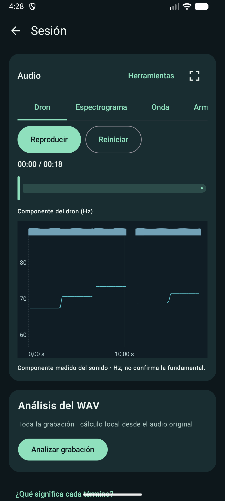
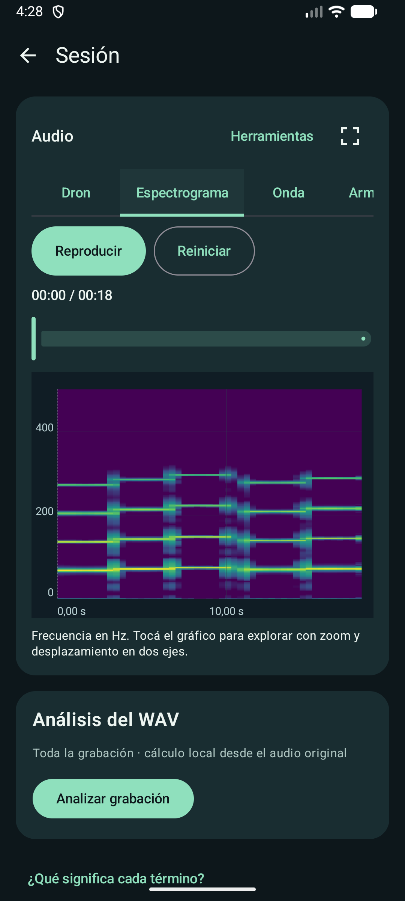
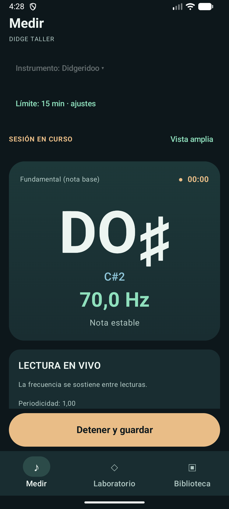
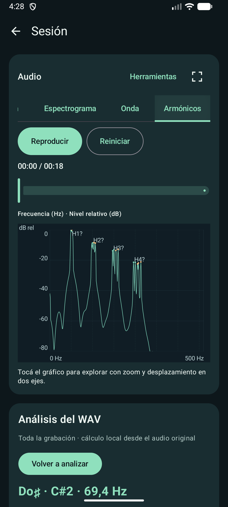

<p align="center">
  
</p>

<h1 align="center">Didge Taller</h1>

<p align="center"><strong>Una app Android sin conexión para escuchar, grabar y explorar el sonido del didgeridoo y la flauta nativa americana.</strong></p>

<p align="center"><a href="README.md">Documentación en inglés</a> · <a href="docs/DEVELOPMENT.md">Guía de desarrollo</a> · <a href="LICENSE">Licencia MIT</a></p>

Didge Taller reúne lecturas de frecuencia en vivo, grabación WAV y análisis de sesiones guardadas. El audio y los análisis quedan en el dispositivo, salvo que decidas exportar un WAV. Es un proyecto personal, sin fines comerciales y todavía en beta: sus lecturas acústicas sirven como evidencia para practicar, no como mediciones físicas calibradas.

## La app en uso

<table>
<tr>
<td width="50%" valign="top">
  <a href="docs/screenshots/showcase-es/session-analysis.png"></a>
  <p><strong>Sesión guardada.</strong> Seguí la componente del dron respaldada por el espectro mientras escuchás; la reproducción y el gráfico comparten el cursor.</p>
</td>
<td width="50%" valign="top">
  <a href="docs/screenshots/showcase-es/spectrogram.png"></a>
  <p><strong>Espectrograma.</strong> Observá cómo cambian la energía espectral y sus bandas armónicas durante la grabación.</p>
</td>
</tr>
<tr>
<td width="50%" valign="top">
  <a href="docs/screenshots/showcase-es/live-measurement.png"></a>
  <p><strong>Medición en vivo.</strong> Leé una estimación de frecuencia aceptada, su nota y el estado de la señal mientras tocás.</p>
</td>
<td width="50%" valign="top">
  <a href="docs/screenshots/showcase-es/harmonic-analysis.png"></a>
  <p><strong>Análisis armónico.</strong> Inspeccioná los picos de un WAV analizado, con frecuencia en Hz y nivel relativo en dB.</p>
</td>
</tr>
</table>

Las cuatro imágenes destacadas son capturas originales de la app real en un emulador configurado en español. Las vistas de sesión usan audio sintético procesado por la app; la lectura en vivo usa PCM sintético controlado. Ilustran el funcionamiento, no la precisión física. Una [captura de Biblioteca](docs/screenshots/showcase-es/library.png) muestra la misma sesión con su vista previa musical. [Condiciones y procedencia de las capturas](docs/screenshots/showcase-es/README.md).

## Qué podés hacer

- **Medir y grabar.** Elegí el perfil de didgeridoo o flauta nativa americana, seguí lecturas de frecuencia en vivo basadas en YIN con indicaciones de incertidumbre y guardá sesiones WAV PCM16 mono. El límite de grabación se configura entre 1 y 30 minutos.
- **Volver a tus sesiones.** Biblioteca muestra grabaciones guardadas con vistas previas de la traza musical. Podés reproducir, buscar una posición, cambiar nombres, exportar WAV, comparar sesiones o fragmentos y recuperar elementos de la Papelera.
- **Explorar el sonido.** Alterná entre Dron, Espectrograma, Onda y Armónicos. Analizá el WAV completo o un intervalo; usá la vista a pantalla completa para ampliar, desplazar e inspeccionar con el cursor. Herramientas reúne escalas, rangos, fragmentos y marcadores.
- **Examinar evidencia técnica.** Una sección separada de Diagnósticos avanzados permite consultar lecturas guardadas, la interpretación YIN y una comparación experimental opcional con SWIPE′ sin alterar el gráfico ordinario del dron.
- **Experimentar con diseños.** El Laboratorio de didgeridoo permite editar el perfil interior, simular resonancias aproximadas y realizar búsquedas exploratorias. No ofrece especificaciones de construcción validadas. Consultá la [guía del Laboratorio](README-LAB.md), en inglés.

La interfaz está disponible en español e inglés mediante los ajustes de idioma de Android. Didge Taller no requiere cuenta, servicios publicitarios ni permiso de Internet.

## Una sesión habitual

1. Elegí un instrumento en **Medir** e iniciá la medición y la grabación.
2. Detené y guardá. El WAV original y las lecturas capturadas quedan disponibles en **Biblioteca**.
3. Abrí la sesión para escucharla y seguir su gráfico. Usá las pestañas horizontales para explorar el espectrograma, la onda o el espectro armónico.
4. Ejecutá el análisis WAV cuando necesites más detalle espectral y armónico. Abrí **Herramientas** para rangos, fragmentos, marcadores y diagnósticos avanzados.

Para didgeridoo, la curva ordinaria de **Dron** sigue una componente espectral de baja frecuencia respaldada por armónicos. **No** es una fundamental de la oscilación labial confirmada físicamente, ni recibe automáticamente una nota musical. Las lecturas YIN en vivo y los diagnósticos avanzados YIN/SWIPE′ responden preguntas distintas; las lecturas históricas originales siguen disponibles. La [guía del explorador de sesiones](docs/SESSION_EXPLORER.md) y las [notas sobre incertidumbre acústica](docs/ACOUSTIC_UNCERTAINTY.md), en inglés, explican estas diferencias.

## Compilar desde el código fuente

Necesitás Android Studio, JDK 17 como base documentada para Gradle, Android SDK Platform 35, NDK 27.0.12077973 y CMake 3.22.1. El repositorio incluye el Gradle Wrapper.

```sh
git clone https://github.com/hmeclazcke/DidgeTaller.git
cd DidgeTaller
```

Abrí el repositorio en Android Studio y ejecutá la configuración `app` en un emulador con Android 8.0 o superior, o en un dispositivo propio. También podés compilar el APK de depuración desde la raíz:

```powershell
.\gradlew.bat :app:assembleDebug
```

```sh
sh ./gradlew :app:assembleDebug
```

El APK se genera en `app/build/outputs/apk/debug/app-debug.apk`. Es una compilación de depuración, no una versión de producción firmada ni una distribución en Google Play. Antes de actualizar una instalación con grabaciones, conservá sus datos y verificá la compatibilidad del paquete y la firma. Ejecutá pruebas instrumentadas solo en un emulador seleccionado explícitamente. La [guía de desarrollo](docs/DEVELOPMENT.md), en inglés, contiene los comandos de prueba y las reglas de protección de dispositivos.

## Ingeniería y límites

La app usa Kotlin, Jetpack Compose/Material 3, `AudioRecord` y `MediaPlayer`. El procesamiento en Kotlin incluye estimación de periodicidad basada en YIN, FFT/STFT, análisis WAV y modelado acústico exploratorio; SWIPE′ usa un pequeño componente C/JNI con [avisos de licencia de origen](app/src/main/assets/third_party/SWIPE.txt). Para empezar por la parte técnica, consultá el [resumen de arquitectura](docs/ARCHITECTURE.md), el [análisis de audio](docs/AUDIO_ANALYSIS.md) y el [registro de validación](docs/VALIDATION.md), en inglés.

Los micrófonos de los teléfonos, el ruido de la sala, los armónicos intensos, las vocalizaciones y los ataques breves pueden producir estimaciones inciertas o ausentes. La app conserva los huecos en lugar de inventar lecturas. Los niveles espectrales son valores digitales relativos, no niveles calibrados de presión sonora; las simulaciones son exploratorias. Las pruebas sintéticas y las capturas de emulador no establecen precisión acústica física ni compatibilidad universal con dispositivos.

Las pruebas JVM y de emulador cubren los caminos relevantes del código. GitHub Actions ejecuta pruebas JVM, compila la app de depuración y el APK de pruebas Android, verifica la localización y genera informes informativos de Detekt y JaCoCo; **no ejecuta** las pruebas instrumentadas Android. La [guía de desarrollo](docs/DEVELOPMENT.md) explica los controles actuales y la [comparación SWIPE′](docs/SWIPE_COMPARISON.md) describe sus límites experimentales; ambos documentos están en inglés.

## Licencia y colaboración

Didge Taller se distribuye bajo la [licencia MIT](LICENSE). DidgeLab y CADSD son referencias de investigación, no motores incluidos; el contexto de atribución está en la [guía del Laboratorio](README-LAB.md). Antes de colaborar, leé [AGENTS.md](AGENTS.md), mantené los cambios acotados y dejá fuera de Git el audio privado, los diagnósticos locales y las credenciales.
