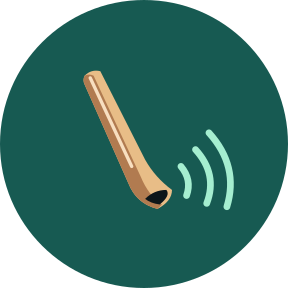
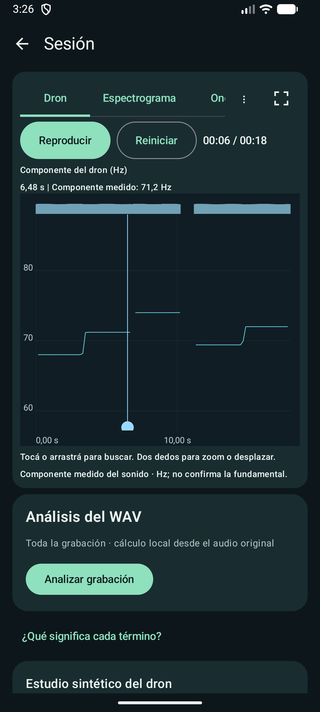
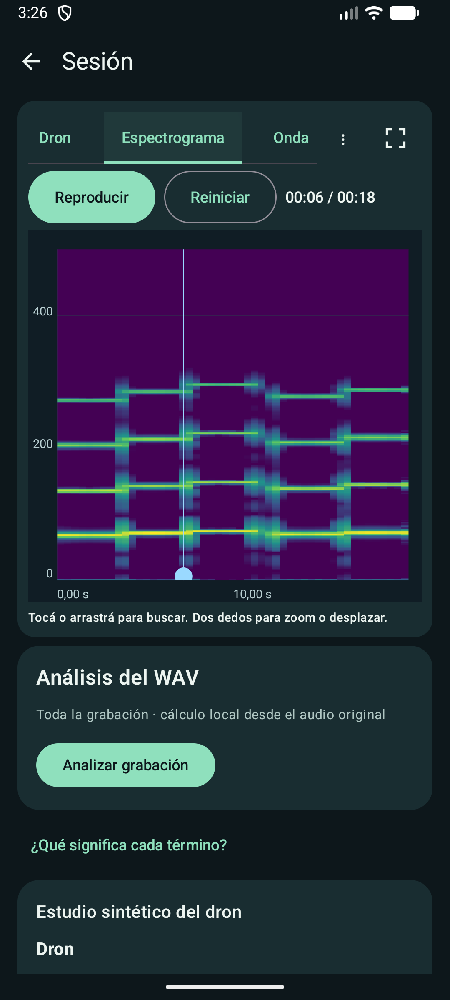
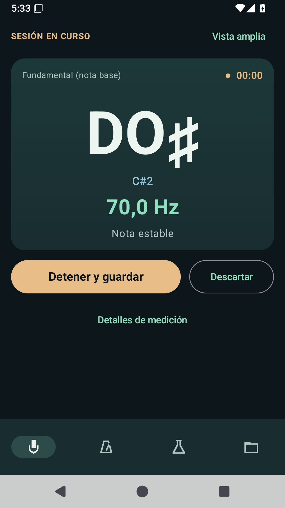
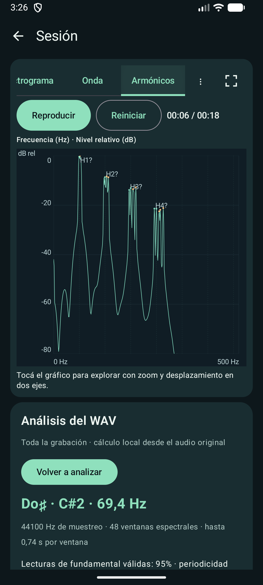
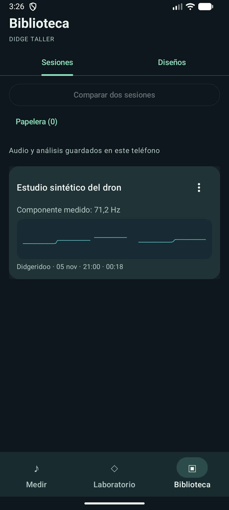

<p align="center">
  
</p>

<h1 align="center">Didge Taller</h1>

<p align="center"><strong>Una app Android sin conexión para escuchar, grabar y explorar el sonido del didgeridoo y la flauta nativa americana.</strong></p>

<p align="center"><a href="README.md">Documentación en inglés</a> · <a href="docs/DEVELOPMENT.md">Guía de desarrollo</a> · <a href="LICENSE">Licencia MIT</a></p>

Didge Taller reúne lecturas de frecuencia en vivo, grabación WAV y análisis de sesiones guardadas. El audio y los análisis quedan en el dispositivo, salvo que decidas exportar un WAV. Es un proyecto personal, sin fines comerciales y todavía en beta: sus lecturas acústicas sirven como evidencia para practicar, no como mediciones físicas calibradas.

## La app en uso

<table>
<tr>
<td width="50%" valign="top">
  <a href="docs/screenshots/showcase-es/session-analysis.png"></a>
  <p><strong>Sesión guardada.</strong> Tocá el gráfico para buscar o arrastrá para recorrer el audio. Cursor, tiempo y lectura de la componente respaldada siguen la misma posición.</p>
</td>
<td width="50%" valign="top">
  <a href="docs/screenshots/showcase-es/spectrogram.png"></a>
  <p><strong>Espectrograma.</strong> Observá cómo cambian la energía espectral y sus bandas armónicas durante la grabación.</p>
</td>
</tr>
<tr>
<td width="50%" valign="top">
  <a href="docs/screenshots/showcase-es/live-measurement.png"></a>
  <p><strong>Medición en vivo.</strong> Leé una estimación de frecuencia aceptada, su nota y el estado de la señal mientras tocás.</p>
</td>
<td width="50%" valign="top">
  <a href="docs/screenshots/showcase-es/harmonic-analysis.png"></a>
  <p><strong>Análisis armónico.</strong> Inspeccioná los picos de un WAV analizado, con frecuencia en Hz y nivel relativo en dB.</p>
</td>
</tr>
<tr><td colspan="2" align="center">
  <a href="docs/screenshots/showcase-es/library.png"></a>
  <p>Biblioteca. Audio original, vista previa de la componente respaldada y acciones de sesión en un mismo lugar.</p>
</td></tr>
</table>

Las cinco imágenes destacadas son capturas originales de la app real en un emulador configurado en español. Las vistas de sesión usan audio sintético procesado por la app; la lectura en vivo usa PCM sintético controlado. Ilustran el funcionamiento, no la precisión física. [Condiciones y procedencia de las capturas](docs/screenshots/showcase-es/README.md).

## Qué podés hacer

- **Practicar con metrónomo.** Desplegá el panel Metrónomo en Medir: 30–240 BPM, iniciar/pausar/detener, compases de 2/4 a 4/4, negras/corcheas/tresillos/semicorcheas, acento inicial y volumen regulable. Los ajustes se conservan; el sonido comienza desactivado y se bloquea antes de abrir el micrófono. Navegar o pasar a segundo plano pausa el ritmo, sin reinicio automático. Los tiempos parten de una grilla monotónica absoluta; siguen sujetos a la latencia de Android y de la salida de audio. [Temporización y aislamiento](docs/METRONOME.md) (documentación técnica en inglés).

- **Medir y grabar.** Elegí el perfil de didgeridoo o flauta nativa americana, seguí lecturas de frecuencia en vivo basadas en YIN con indicaciones de incertidumbre y guardá sesiones WAV PCM16 mono. El límite de grabación se configura entre 1 y 30 minutos.
- **Volver a tus sesiones.** Biblioteca muestra grabaciones guardadas con vistas previas de la traza musical. Podés reproducir, buscar una posición, cambiar nombres, exportar WAV, comparar sesiones o fragmentos y recuperar elementos de la Papelera.
- **Explorar el sonido.** Alterná entre Dron, Espectrograma, Onda y Armónicos. Analizá el WAV completo o un intervalo; usá la vista a pantalla completa para ampliar, desplazar e inspeccionar con el cursor. Herramientas reúne escalas, rangos, fragmentos y marcadores.
- **Examinar evidencia técnica.** Una sección separada de Diagnósticos avanzados permite consultar lecturas guardadas, la interpretación YIN y una comparación experimental opcional con SWIPE′ sin alterar el gráfico ordinario del dron.
- **Experimentar con diseños.** El Laboratorio de didgeridoo permite editar el perfil interior, simular resonancias aproximadas y realizar búsquedas exploratorias. No ofrece especificaciones de construcción validadas. Consultá la [guía del Laboratorio](README-LAB.md), en inglés.

La interfaz está disponible en español e inglés mediante los ajustes de idioma de Android. Didge Taller no requiere cuenta, servicios publicitarios ni permiso de Internet.

Durante la grabación o reproducción activa en primer plano, la app solicita mantener la pantalla encendida. Al pausar o terminar libera esa solicitud; no habilita el micrófono en segundo plano.

## Una sesión habitual

1. Elegí un instrumento en **Medir** e iniciá la medición y la grabación.
2. Guardá para conservar el WAV original y las lecturas capturadas en **Biblioteca**, o descartá después de confirmar.
3. Abrí la sesión para escucharla y seguir su gráfico. Usá las pestañas horizontales para explorar el espectrograma, la onda o el espectro armónico.
4. Ejecutá el análisis WAV cuando necesites más detalle espectral y armónico. Abrí **Herramientas** para rangos, fragmentos, marcadores y diagnósticos avanzados.

Para didgeridoo, la curva ordinaria de **Dron** sigue una componente espectral de baja frecuencia respaldada por armónicos. **No** es una fundamental de la oscilación labial confirmada físicamente, ni recibe automáticamente una nota musical. Las lecturas YIN en vivo y los diagnósticos avanzados YIN/SWIPE′ responden preguntas distintas; las lecturas históricas originales siguen disponibles. La [guía del explorador de sesiones](docs/SESSION_EXPLORER.md) y las [notas sobre incertidumbre acústica](docs/ACOUSTIC_UNCERTAINTY.md), en inglés, explican estas diferencias.

## Compilar desde el código fuente

Necesitás Android Studio, un JDK 21 instalado para el daemon de Gradle, Android SDK Platform 35, Build Tools 36.0.0, NDK 27.0.12077973 y CMake 3.22.1. El repositorio fija Gradle 9.6.0 y AGP 9.4.1; el bytecode de la aplicación sigue apuntando a Java 17. La guía de calidad explica las opciones temporales de compatibilidad Kotlin/DSL.

```sh
git clone https://github.com/hmeclazcke/DidgeTaller.git
cd DidgeTaller
```

Abrí el repositorio en Android Studio y ejecutá la configuración `app` en un emulador con Android 8.0 o superior, o en un dispositivo propio. También podés compilar el APK de depuración desde la raíz:

```powershell
.\gradlew.bat :app:assembleDebug
```

```sh
sh ./gradlew :app:assembleDebug
```

El APK se genera en `app/build/outputs/apk/debug/app-debug.apk`. Es una compilación de depuración, no una versión de producción firmada ni una distribución en Google Play. Antes de actualizar una instalación con grabaciones, conservá sus datos y verificá la compatibilidad del paquete y la firma. Ejecutá pruebas instrumentadas solo en un emulador seleccionado explícitamente. La [guía de desarrollo](docs/DEVELOPMENT.md), en inglés, contiene los comandos de prueba y las reglas de protección de dispositivos.

## Ingeniería y límites

La app usa Kotlin, Jetpack Compose/Material 3, `AudioRecord` y `MediaPlayer`. El procesamiento en Kotlin incluye estimación de periodicidad basada en YIN, FFT/STFT, análisis WAV y modelado acústico exploratorio; SWIPE′ usa un pequeño componente C/JNI con [avisos de licencia de origen](app/src/main/assets/third_party/SWIPE.txt). Para empezar por la parte técnica, consultá el [resumen de arquitectura](docs/ARCHITECTURE.md), el [análisis de audio](docs/AUDIO_ANALYSIS.md) y el [registro de validación](docs/VALIDATION.md), en inglés.

Los micrófonos de los teléfonos, el ruido de la sala, los armónicos intensos, las vocalizaciones y los ataques breves pueden producir estimaciones inciertas o ausentes. La app conserva los huecos en lugar de inventar lecturas. Los niveles espectrales son valores digitales relativos, no niveles calibrados de presión sonora; las simulaciones son exploratorias. Las pruebas sintéticas y las capturas de emulador no establecen precisión acústica física ni compatibilidad universal con dispositivos.

Los controles rápidos de GitHub Actions ejecutan ambas variantes JVM y controles medidos de regresión. Los cambios relevantes en main también ejecutan la suite completa de emulador con un informe separado de cobertura Android; compilar su APK no equivale a aprobarla. Consultá la [base de calidad](docs/quality/QUALITY_BASELINE.md), [Desarrollo](docs/DEVELOPMENT.md) y [comparación SWIPE](docs/SWIPE_COMPARISON.md).

## Prácticas de ingeniería - ub-mode oficial de Uncle Bob

Didge Taller usa el [ub-mode](https://github.com/unclebob/ub-mode) original de Robert C. Martin, sin modificaciones, con licencia MIT y [procedencia fijada](.agents/skills/ub-mode/UPSTREAM.md). Es un conjunto de instrucciones de ingeniería; la seguridad del proyecto y su aplicación a Kotlin se definen aparte en [AGENTS.md](AGENTS.md) y la [guía de calidad](docs/quality/QUALITY_GUIDE.md), en inglés.

- **First Make it Work:** modelar el dominio, validar los límites, asignar propietarios a las operaciones y aplicar TDD/rojo-verde-refactor ante defectos demostrados.
- **Then Make it Right:** refactorizar con pruebas de caracterización, reducir conocimiento duplicado (DRY) e investigar complejidad, cobertura, CRAP-L y mutaciones supervivientes. Los escenarios de aceptación de estilo BDD no implican una integración con Cucumber.
- **Practice:** investigación focalizada, commits pequeños y revisables, evidencia reproducible y validación proporcional al riesgo; reutilizar evidencia vigente sin ocultar controles ausentes.

El [caso de estudio](docs/engineering/REBUILD_CASE_STUDY.md) y el [informe finito de aceptación](docs/engineering/REBUILD_ACCEPTANCE.md), en inglés, explican la reconstrucción productiva en `refactor/uncle-bob-rebuild`. Main permanece como referencia de comportamiento; el [PR #1](https://github.com/hmeclazcke/DidgeTaller/pull/1) sigue en borrador para revisión del propietario. Su tabla de evidencia enlaza trabajos y artefactos de CI para la revisión exacta; un control obligatorio fallido o pendiente impide considerar lista la integración.

Kotlin puro posee DSP, fases de grabación, intención de reproducción, solicitudes de sesión/análisis, geometría temporal y lecturas científicas. Los adaptadores Android poseen dispositivos, archivos y planificación; Compose presenta el estado. Las autorizaciones revocables impiden que operaciones reemplazadas o destruidas publiquen progreso o resultados. Las trazas canónicas mantienen ciclos de vida independientes y acotados por sesión. La publicación protegida de metadatos conserva índices dañados y sesiones históricas. El renderizado separa geometría preparada y dibujo de la cámara y los gestos; siguen protegidos la búsqueda directa sobre el gráfico y el contrato estricto de pausa de 80 ms.

| Control | Integración real y obligatoriedad |
| --- | --- |
| Pruebas de comportamiento | Gradle/JUnit en debug y release; pruebas deterministas de propiedad y errores; contratos acústicos sintéticos y comparación diferencial con main fijado |
| Android | Instrumentación ejecutada en emulador, informes JaCoCo separados y controles EN/ES compactos con fuente al 150% y paisaje |
| Complejidad y cobertura | Detekt y JaCoCo; PSI del compilador y metadata exacta Kotlin/JVM producen **CRAP-L** por líneas del método, con controles medidos de regresión |
| Código modificado | Fallan las mediciones elegibles ausentes o ambiguas y los informes obligatorios faltantes; los casos no soportados y puentes revisados sobre el objetivo conservan excepciones explícitas vinculadas a su contenido |
| DRY | PMD CPD para Kotlin detecta regresiones de bloques duplicados por tokens, junto con revisión del conocimiento de dominio repetido |
| Fortaleza de las pruebas | PIT gratuito ejecuta mutantes reales de bytecode productivo; el umbral original de gestos es obligatorio y el dominio ampliado es informativo, pero debe ejecutar y producir un informe válido |

Estas integraciones para Kotlin persiguen los objetivos de Crapper/Dryer/Mutator sin afirmar que esos ejecutables originales estén instalados. CRAP-L usa cobertura de **líneas** del método, no cobertura de caminos base de Crapper. Los límites de Compose/compilador, contratos abstractos y declaraciones anónimas permanecen inventariados, sin puntajes fabricados. Las coberturas JVM y Android nunca se mezclan; una puntuación de mutaciones seleccionadas no representa toda la aplicación.

Los pushes y PR relevantes ejecutan compilación rápida, ambas variantes JVM, localización, Lint, Detekt y controles medidos. Los pushes relevantes de main/rebuild y la ejecución manual lanzan el flujo completo de emulador; las mutaciones amplias se solicitan manualmente. Los filtros evitan trabajo ajeno, aunque el diff acumulado de un PR abierto puede volver a activar controles rápidos ante un commit documental. La [guía de calidad](docs/quality/QUALITY_GUIDE.md), en inglés, contiene comandos verificados, informes, frecuencia y límites técnicos. Se conservan las capturas reales y los límites acústicos de la versión beta.

## Licencia y colaboración

Didge Taller se distribuye bajo la [licencia MIT](LICENSE). DidgeLab y CADSD son referencias de investigación, no motores incluidos; el contexto de atribución está en la [guía del Laboratorio](README-LAB.md). Antes de colaborar, leé [AGENTS.md](AGENTS.md), mantené los cambios acotados y dejá fuera de Git el audio privado, los diagnósticos locales y las credenciales.
