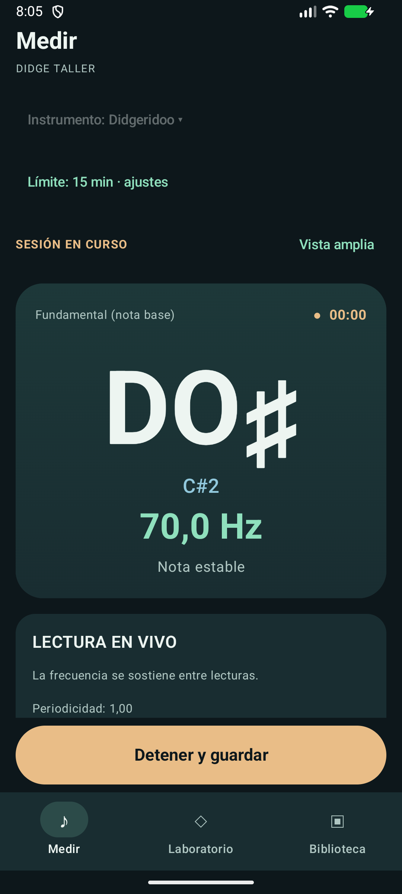
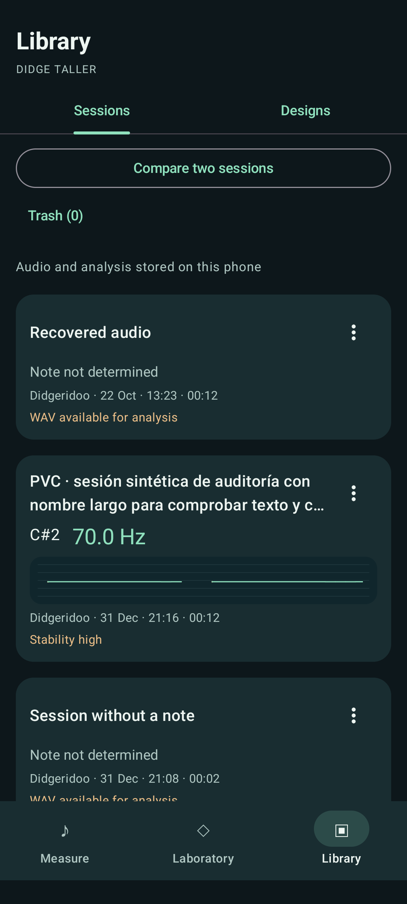
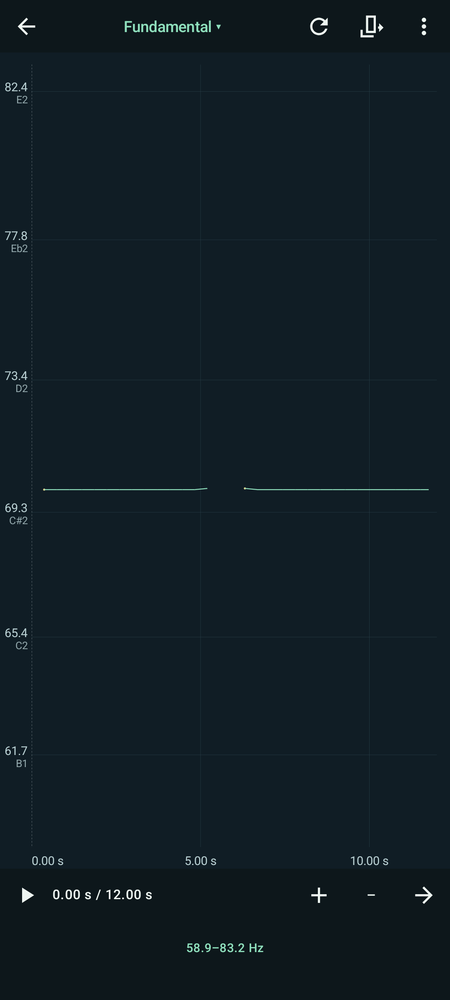
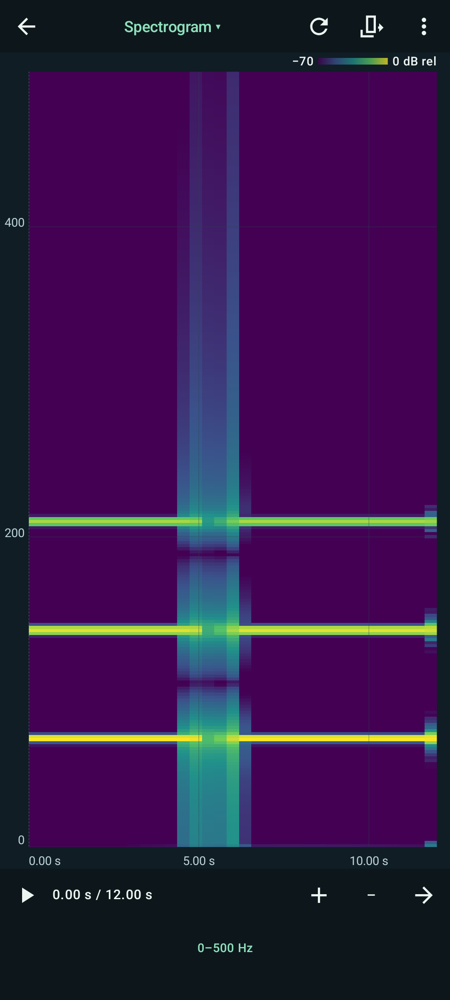

# Didge Taller

[English](README.md) | [Español](README.es.md)

Una app Android nativa para estudiar el sonido del didgeridoo y la flauta nativa americana. Permite medir la frecuencia, grabar sesiones de práctica y explorar cómo cambian el tono y la energía espectral a lo largo del tiempo. También incluye un laboratorio experimental para investigar la geometría interna del didgeridoo y sus resonancias simuladas.

Didge Taller funciona sin conexión, cuentas, publicidad ni acceso a la red. Las grabaciones y los análisis quedan en el dispositivo, salvo que los exportes. Es un proyecto personal, sin fines comerciales, en beta; las estimaciones acústicas y las predicciones de diseño tienen los límites que se explican más abajo.

## Funciones

### Medir y grabar

- Frecuencia, nota musical y desviación en cents en tiempo real mediante estimación basada en YIN, con indicaciones de señal e incertidumbre.
- Perfiles de **Didgeridoo** (35–140 Hz inicialmente, ampliable a 220 Hz) y **Flauta nativa americana** (200–1600 Hz).
- Una acción inicia la medición y la grabación WAV PCM16 mono. Al detener, se guarda la sesión con las lecturas de frecuencia capturadas.
- Límites de grabación de 1, 5, 15 o 30 minutos; el valor inicial es 15 minutos. Al salir de Medir o pasar la app a segundo plano, la grabación se detiene y se guarda.
- Vista amplia de medición para facilitar la lectura mientras tocás.

### Escuchar y explorar

La vista **Fundamental** de las sesiones de didgeridoo permite activar **Comparar
estimadores de tono**: agrega una curva discontinua de **SWIPE′ · experimental**
junto a YIN, calculada sin conexión a partir del WAV de 44,1 kHz. Al desactivarla
se recupera la vista original. No corrige mediciones ni confirma la frecuencia
física del drone. La flauta conserva su análisis YIN. Ver [alcances y validación](docs/SWIPE_COMPARISON.md).

- **Biblioteca de sesiones** con reproducción, cambio de nombre, exportación WAV y eliminación recuperable mediante la Papelera.
- Vistas de **Fundamental**, **Espectrograma**, **Forma de onda** y **Armónicos**, con exploración a pantalla completa, zoom, desplazamiento, inspección con cursor y restablecimiento de la vista.
- Reproducción, búsqueda de posición, selección de fragmentos y bucle, con un cursor vinculado a la posición del reproductor.
- Análisis del WAV completo o de un intervalo: espectro de potencia, candidatos armónicos, resúmenes de frecuencia y energía por bandas espectrales.
- Inspección opcional de señal desde el WAV: separa periodicidad aceptada, períodos alternativos, familias espectrales candidatas y baja energía, sin cambiar Fundamental. Consultá la [decisión de ingeniería](docs/PITCH_RESOLUTION.md), en inglés.
- Comparación A/B de sesiones o fragmentos con espectros superpuestos y normalización opcional.

### Experimentar con diseños

El **Laboratorio** de didgeridoo ofrece edición del perfil interior, preajustes, simulación aproximada de impedancia de entrada y búsqueda evolutiva con tres resonancias objetivo. Los diseños guardados pueden asociarse con sesiones de didgeridoo para observar predicciones junto a grabaciones. Son herramientas exploratorias: no constituyen especificaciones de construcción validadas ni sirven para diseñar flautas. Consultá la [guía del Laboratorio](README-LAB.md), en inglés.

La interfaz está disponible en **inglés y español**, según la configuración de idioma de Android. Los nombres y las anotaciones guardados conservan su texto original.

## Capturas

Capturas reales de la aplicación en emulador, con señales sintéticas y sesiones de prueba. El ejemplo de medición en vivo está en español; las otras tres muestran la interfaz en inglés. Ilustran la interfaz, no la precisión de una medición física.

| Medición en vivo | Biblioteca de sesiones | Fundamental | Espectrograma |
| --- | --- | --- | --- |
|  |  |  |  |

El [índice de capturas en inglés y español](docs/screenshots/localization/INDEX.md) incluye las vistas de onda y diseño, junto con las condiciones de captura. La [evidencia de medición en vivo](docs/screenshots/v326-final/README.md) documenta su entrada sintética. Algunas imágenes son anteriores a las últimas indicaciones de incertidumbre y a la nueva ubicación de los controles de reproducción.

## Tecnologías

| Área | Implementación |
| --- | --- |
| Lenguaje e interfaz | Kotlin 2.2.21, Jetpack Compose BOM 2025.04.01, Material 3, Navigation Compose |
| Compilación | Gradle Wrapper 8.13, Android Gradle Plugin 8.13.2, destino Java 17 |
| Android | SDK mínimo 26 (Android 8.0), SDK de compilación y destino 35; identificador `ar.didgetaller` |
| Audio y procesamiento | `AudioRecord` y `MediaPlayer` de Android; implementaciones Kotlin de estimación basada en YIN, FFT radix-2, STFT, procesamiento WAV y modelado acústico |
| Calidad | JUnit 4, pruebas instrumentadas AndroidX/Compose, GitHub Actions, Detekt 1.23.8, JaCoCo 0.8.15 |

Las versiones están definidas en los archivos Gradle de la [raíz](build.gradle.kts) y del [módulo app](app/build.gradle.kts). El [manifiesto](app/src/main/AndroidManifest.xml) solicita acceso al micrófono y no incluye permiso de Internet.

## Primeros pasos

Para compilar se necesitan también NDK 27.0.12077973 y CMake 3.22.1, disponibles
en SDK Manager o mediante Gradle con las licencias aceptadas. La app no necesita
Python ni una computadora para esta comparación. Se incluyen los
[avisos de licencia del componente](app/src/main/assets/third_party/SWIPE.txt).

Necesitás Git, Android Studio con un JDK de Gradle compatible con el proyecto (JDK 17 es la base documentada) y Android SDK Platform 35. No hace falta instalar Gradle por separado. La primera sincronización descarga la distribución del wrapper y las dependencias.

1. Cloná el repositorio con una cuenta que tenga acceso:

   ```sh
   git clone https://github.com/hmeclazcke/DidgeTaller.git
   cd DidgeTaller
   ```

2. En Android Studio, elegí **Open** y seleccioná la raíz que contiene `settings.gradle.kts`. Configurá el JDK de Gradle e instalá SDK Platform 35 desde SDK Manager; después sincronizá.
3. Compilá la aplicación de depuración y ejecutá las pruebas JVM desde la raíz:

   ```powershell
   # Windows PowerShell
   .\gradlew.bat :app:assembleDebug
   .\gradlew.bat :app:testDebugUnitTest
   ```

   ```sh
   # macOS / Linux
   sh ./gradlew :app:assembleDebug
   sh ./gradlew :app:testDebugUnitTest
   ```

4. Seleccioná un emulador Android 8.0 o superior, o un dispositivo dedicado a pruebas, y ejecutá la configuración `app` en Android Studio. Concedé permiso de micrófono al iniciar la medición. El APK de depuración se genera en `app/build/outputs/apk/debug/app-debug.apk`.

Si la instalación existente tiene grabaciones, preservá los datos y verificá la compatibilidad del paquete y la firma antes de actualizar. No desinstales ni borres los datos para resolver un conflicto de instalación. Las pruebas instrumentadas corresponden a un emulador seleccionado explícitamente.

La [guía de desarrollo](docs/DEVELOPMENT.md), en inglés, reúne los controles de calidad, la resolución de problemas del wrapper y las reglas de protección de dispositivos.

## Cómo usarla

1. Abrí **Medir / Measure** y elegí **Instrumento / Instrument** antes de empezar. Para didgeridoo, ampliá el rango a 220 Hz si hace falta. El límite de grabación se configura en **ajustes / settings**.
2. Tocá **Iniciar medición / Start measurement**, permití el acceso al micrófono y tocá el instrumento. Interpretá juntos frecuencia, nota, cents y estado de la señal. Un resultado incierto puede dejar la frecuencia en blanco aunque haya sonido.
3. Tocá **Detener y guardar / Stop and save**. La sesión aparece en **Biblioteca → Sesiones / Library → Sessions**. Aunque no se haya determinado una nota confiable, se conserva el audio.
4. Abrí una sesión y explorá **Fundamental** para ver la evolución de la frecuencia o **Espectrograma / Spectrogram** para observar la energía espectral. Forma de onda y Armónicos muestran la amplitud de las muestras y el espectro. Abrí un gráfico a pantalla completa para ampliar, desplazar e inspeccionar; usá **Herramientas / Tools** para los rangos y los controles de fragmentos.
5. Usá **Reproducir / Play**, **Pausar / Pause** y **Reiniciar / Restart** para escuchar. Buscá una posición o seleccioná un fragmento para repetirlo en bucle. Atrás de Android vuelve del visor a la sesión; al abandonar la sesión se detiene la reproducción.

La [guía del explorador de sesiones](docs/SESSION_EXPLORER.md), en inglés, explica colores, lecturas ausentes, comparación y Papelera. La [guía del Laboratorio](README-LAB.md) cubre el flujo de diseño por separado.

## Detección de frecuencia y limitaciones

YIN estima la periodicidad comparando una ventana breve de señal con versiones desplazadas de ella misma. Un patrón repetido permite proponer un período y convertirlo en frecuencia. Didge Taller usa una implementación basada en YIN con ventanas y rangos por instrumento; no toma simplemente el mayor pico de la FFT como fundamental.

- El micrófono, el filtrado de graves del teléfono, el ruido, los ataques, los armónicos intensos y las vocalizaciones complejas pueden generar periodicidades débiles o competidoras.
- La fundamental de toda la mezcla grabada puede ser distinta del drone que busca seguir quien toca. La app no separa el drone de una voz simultánea.
- Algunas ventanas se rechazan en lugar de asignarles una frecuencia engañosa. Fundamental conserva las ausencias y el acceso a originales inciertos; los enlaces visuales no crean mediciones intermedias.
- La confianza YIN describe periodicidad, no una probabilidad calibrada de acertar la nota. Los niveles espectrales son digitales y relativos, no niveles calibrados de presión sonora.
- El problema informado con la **vocalización «I» sigue sin resolverse**. Los candidatos de diagnóstico explican la evidencia; no son estimaciones corregidas ni frecuencias guardadas.
- El cursor y los bucles de reproducción no tienen precisión de muestra ni continuidad garantizada. Ampliar el espectrograma no aumenta su resolución temporal o frecuencial original.

Las pruebas sintéticas, la reproducción analítica de audio grabado y las verificaciones en emulador aportan evidencia de ingeniería. No establecen precisión científica, compatibilidad universal con dispositivos ni predicciones físicas de diseño validadas. Siguen pendientes el contraste con un afinador independiente, la grabación física sostenida y su consumo de batería, la sincronía audible y un recorrido completo con TalkBack. Consultá [análisis de audio](docs/AUDIO_ANALYSIS.md), [incertidumbre acústica](docs/ACOUSTIC_UNCERTAINTY.md) y el [registro fechado de validación](docs/VALIDATION.md).

## Arquitectura

El único módulo `app` separa procesamiento y modelos independientes de Android (`core/`), captura y reproducción (`audio/`), almacenamiento local y cachés derivados (`data/`) e interfaz Compose (`ui/`). `TallerViewModel` coordina las tareas y el estado de sesión; Navigation Compose administra la pila de navegación.

El [resumen de arquitectura](docs/ARCHITECTURE.md) es el punto de entrada técnico. La [documentación de localización](docs/LOCALIZATION.md) explica los límites de traducción. Los informes históricos se conservan en `docs/`: sus resultados fechados describen revisiones concretas, no garantías permanentes del proyecto.

## Pruebas y calidad

Las pruebas JVM cubren procesamiento de señal, manejo WAV, resúmenes y matemática de gráficos. Las pruebas Android verifican persistencia, navegación, reproducción y comportamiento Compose con datos aislados en emulador. GitHub Actions ejecuta las pruebas JVM, compila la app de depuración y el APK de pruebas, valida la localización y genera informes Detekt y JaCoCo; **no** ejecuta la suite del emulador.

Los hallazgos de Detekt y la cobertura JVM de JaCoCo son informativos, sin un umbral obligatorio de calidad. La cobertura no mide precisión acústica física ni reemplaza las pruebas Android. La [guía de desarrollo](docs/DEVELOPMENT.md) contiene comandos y ubicaciones de informes; las auditorías de [Detekt](docs/DETEKT_AUDIT.md) y [cobertura](docs/COVERAGE_AUDIT.md) conservan los resultados fechados.

## Colaboración y licencia

Todavía no hay un proceso formal de colaboración documentado. Antes de preparar cambios, leé [AGENTS.md](AGENTS.md) y la [guía de desarrollo](docs/DEVELOPMENT.md), mantené un alcance concreto y excluí audio privado, diagnósticos locales, credenciales y archivos generados.

El repositorio incluye una [licencia MIT](LICENSE). DidgeLab y CADSD son referencias de investigación, no motores incluidos ni dependencias; sus licencias no reemplazan la del repositorio. La [guía del Laboratorio](README-LAB.md) explica el contexto de atribución.
