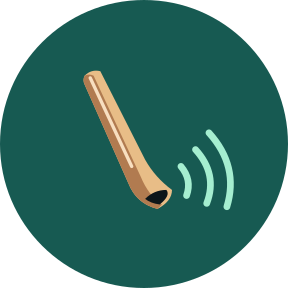
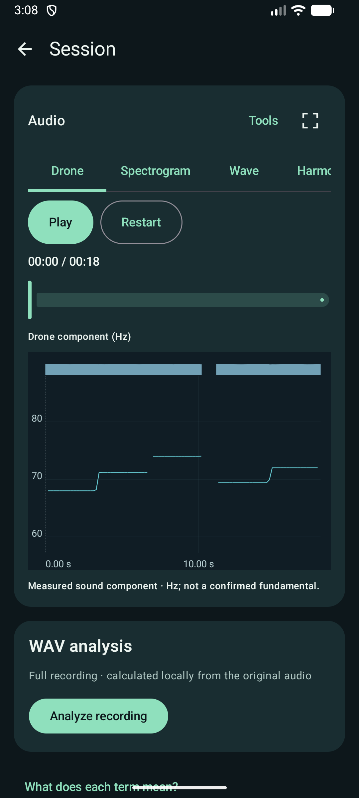
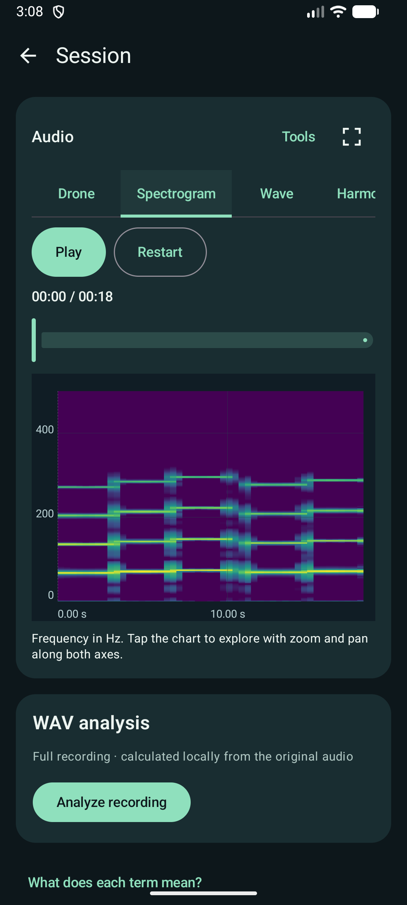
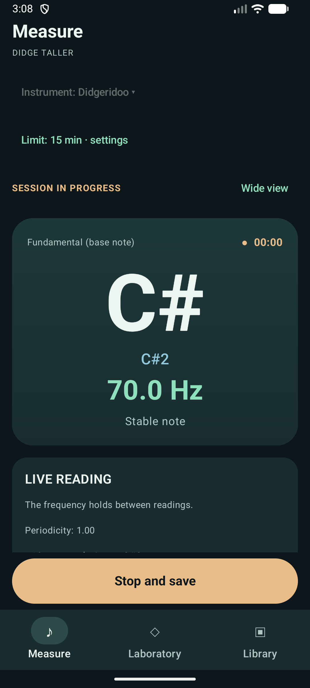
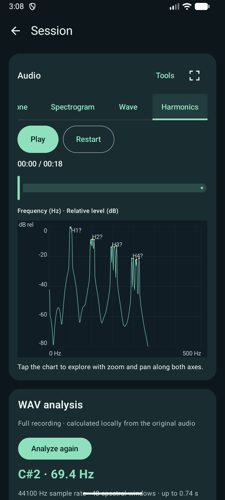

<p align="center">
  
</p>

<h1 align="center">Didge Taller</h1>

<p align="center"><strong>An offline Android workspace for listening, recording, and exploring didgeridoo and Native American flute sound.</strong></p>

<p align="center"><a href="README.es.md">Spanish documentation</a> · <a href="docs/DEVELOPMENT.md">Development guide</a> · <a href="LICENSE">MIT license</a></p>

Didge Taller brings live pitch readings, WAV recording, and saved-session analysis into one app. It keeps audio and analysis on the device unless you choose to export a WAV. The app is a personal, noncommercial beta: its acoustic readings are useful practice evidence, not calibrated physical measurements.

## Inside the app

<table>
<tr>
<td width="50%" valign="top">
  <a href="docs/screenshots/showcase/session-analysis.png"></a>
  <p><strong>Saved session.</strong> Follow the supported drone component while listening; playback and the chart share a cursor.</p>
</td>
<td width="50%" valign="top">
  <a href="docs/screenshots/showcase/spectrogram.png"></a>
  <p><strong>Spectrogram.</strong> See how spectral energy and its harmonic bands change through the recording.</p>
</td>
</tr>
<tr>
<td width="50%" valign="top">
  <a href="docs/screenshots/showcase/live-measurement.png"></a>
  <p><strong>Live measurement.</strong> Read an accepted pitch estimate, note, and signal status while playing.</p>
</td>
<td width="50%" valign="top">
  <a href="docs/screenshots/showcase/harmonic-analysis.png"></a>
  <p><strong>Harmonic analysis.</strong> Inspect peaks from an analyzed WAV, with frequency in Hz and relative level in dB.</p>
</td>
</tr>
</table>

The four featured images are unaltered captures from the real app on an English-configured emulator. The session images use synthetic demonstration audio processed by the app; the live reading uses controlled synthetic PCM. They illustrate behavior, not physical accuracy. A [Library capture](docs/screenshots/showcase/library.png) also shows the same session as a trace preview. [Capture conditions and provenance](docs/screenshots/showcase/README.md).

## What you can do

- **Measure and record.** Choose a didgeridoo or Native American flute profile, follow YIN-based live pitch readings with uncertainty feedback, and save mono PCM16 WAV sessions. Recording limits are configurable from 1 to 30 minutes.
- **Return to your sessions.** The Library shows saved recordings with musical-trace previews. Play, seek, rename, export WAV, compare sessions or excerpts, and recover items from Trash.
- **Explore the sound.** Switch among Drone, Spectrogram, Wave, and Harmonics in a session. Analyze the whole WAV or a selected interval; use full-screen zoom, pan, cursor inspection, and playback-linked navigation. Tools contain scales, ranges, excerpts, and markers.
- **Examine technical evidence.** A separate Advanced diagnostics area exposes saved readings, YIN interpretation, and optional experimental SWIPE′ comparison without changing the ordinary drone chart.
- **Experiment with design.** The didgeridoo Laboratory offers bore-profile editing, approximate resonance simulation, and exploratory search. It is not a validated construction specification. See the [Laboratory guide](README-LAB.md).

The interface supports English and Spanish through Android's app-language settings. Didge Taller needs no account, advertising service, or Internet permission.

## A typical session

1. Choose an instrument in **Measure**, then start measurement and recording.
2. Stop and save. The original WAV and its captured readings remain available in **Library**.
3. Open the session to listen and follow its chart. Use the horizontal tabs to inspect the spectrogram, waveform, or harmonic spectrum.
4. Run WAV analysis when you want spectral and harmonic detail. Open **Tools** for ranges, excerpts, markers, and advanced diagnostics.

For didgeridoo, the ordinary **Drone** curve tracks a supported low-frequency spectral component. It is **not** a physically confirmed lip-oscillator fundamental, and it is not automatically assigned a musical note. Live YIN readings and advanced YIN/SWIPE′ diagnostics answer different questions; the original historical readings remain accessible. The [session explorer guide](docs/SESSION_EXPLORER.md) and [acoustic uncertainty notes](docs/ACOUSTIC_UNCERTAINTY.md) explain these distinctions.

## Build from source

You need Android Studio, JDK 17 as the documented Gradle baseline, Android SDK Platform 35, NDK 27.0.12077973, and CMake 3.22.1. The repository includes the Gradle wrapper.

```sh
git clone https://github.com/hmeclazcke/DidgeTaller.git
cd DidgeTaller
```

Open the repository in Android Studio and run the `app` configuration on an Android 8.0+ emulator or a device you control. Or build the debug APK from the repository root:

```powershell
# Windows PowerShell
.\gradlew.bat :app:assembleDebug
```

```sh
# macOS / Linux
sh ./gradlew :app:assembleDebug
```

The APK is written to `app/build/outputs/apk/debug/app-debug.apk`. This is a debug build, not a signed production release or a Play Store distribution. Preserve app data and check signing compatibility before updating an installation that contains recordings. Run instrumented tests only on an explicitly selected emulator. The [development guide](docs/DEVELOPMENT.md) has test commands and device-safety details.

## Engineering and limits

The Android app uses Kotlin, Jetpack Compose/Material 3, `AudioRecord`, and `MediaPlayer`. Kotlin DSP code handles YIN-based periodicity, FFT/STFT, WAV analysis, and exploratory acoustic modeling; SWIPE′ uses a small C/JNI component with [upstream notices](app/src/main/assets/third_party/SWIPE.txt). Start with the [architecture overview](docs/ARCHITECTURE.md), [audio analysis](docs/AUDIO_ANALYSIS.md), and [validation records](docs/VALIDATION.md).

Phone microphones, room noise, strong harmonics, vocalizations, and short attacks can make a pitch estimate uncertain or unavailable. The app preserves gaps rather than inventing readings. Spectral levels are relative digital values, not calibrated sound-pressure levels; simulation results are exploratory. Synthetic tests and emulator captures do not establish physical acoustic accuracy or universal device compatibility.

JVM and emulator tests cover the relevant code paths. GitHub Actions runs JVM tests, builds the debug and Android-test APKs, checks localization, and produces informational Detekt and JaCoCo reports; it **does not execute** Android instrumentation tests. See [Development](docs/DEVELOPMENT.md) for current checks and [SWIPE′ comparison](docs/SWIPE_COMPARISON.md) for its experimental limits.

## License and contributions

Didge Taller is licensed under [MIT](LICENSE). DidgeLab and CADSD are research references, not bundled engines; attribution context is in the [Laboratory guide](README-LAB.md). Before contributing, read [AGENTS.md](AGENTS.md), keep changes focused, and leave private audio, local diagnostics, and credentials out of Git.
