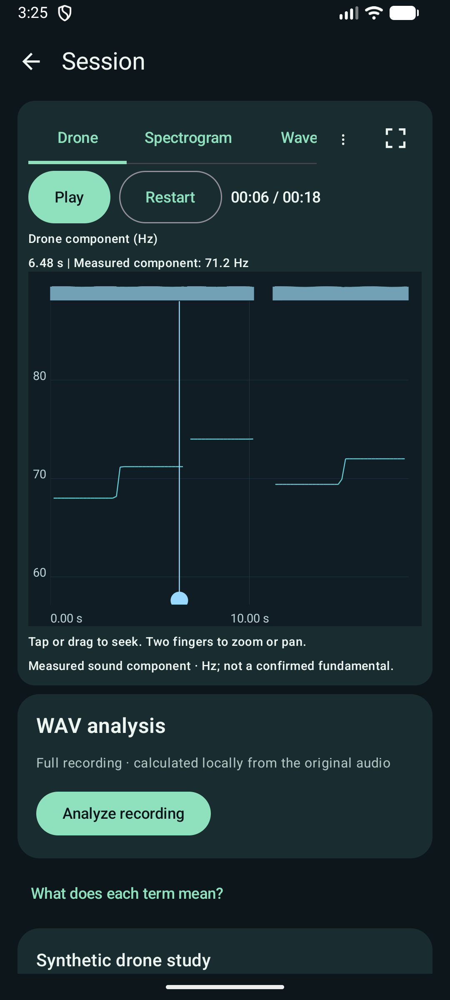
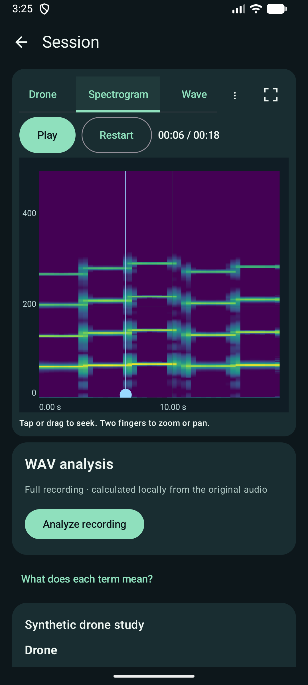
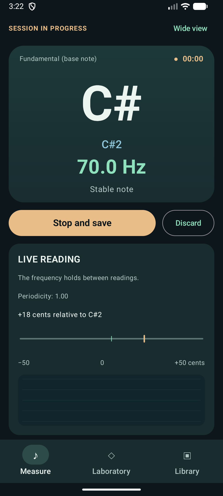
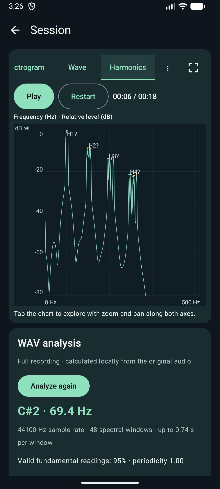
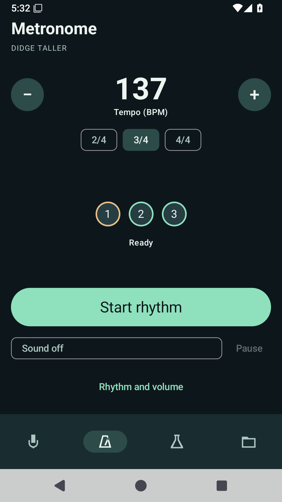
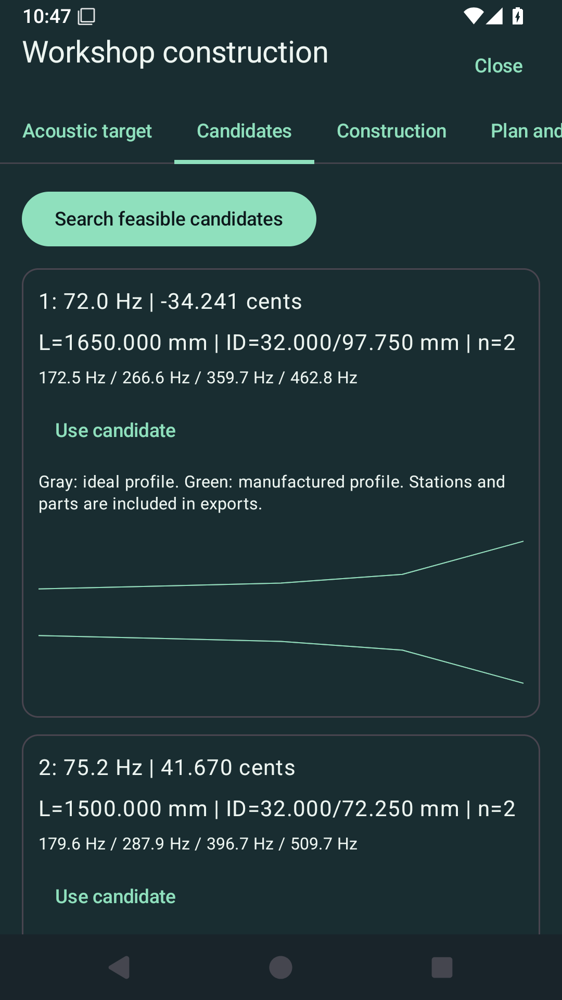
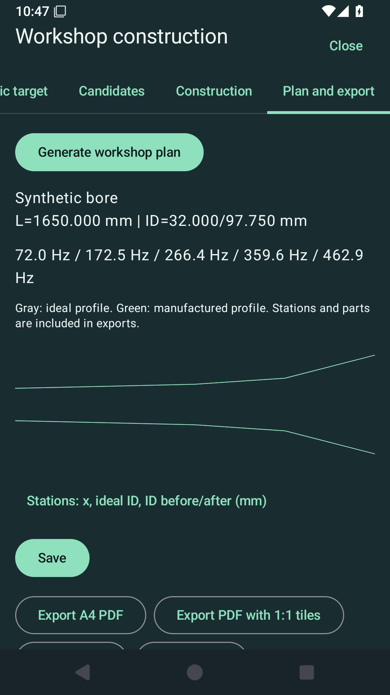

<p align="center">
  
</p>

<h1 align="center">Didge Taller</h1>

<p align="center"><strong>An offline Android workspace for listening, recording, and exploring didgeridoo and Native American flute sound.</strong></p>

<p align="center"><a href="README.es.md">Spanish documentation</a> · <a href="docs/DEVELOPMENT.md">Development guide</a> · <a href="LICENSE">MIT license</a></p>

Didge Taller brings live pitch readings, WAV recording, and saved-session analysis into one app. It keeps audio and analysis on the device unless you choose to export a WAV. The app is a personal, noncommercial beta: its acoustic readings are useful practice evidence, not calibrated physical measurements.

## Screenshots

<table>
<tr>
<td width="50%" valign="top">
  <a href="docs/screenshots/showcase/session-analysis.png"></a>
  <p><strong>Saved session.</strong> Tap the graph to seek, or drag across it to scrub. The cursor, time and supported component readout follow the same position.</p>
</td>
<td width="50%" valign="top">
  <a href="docs/screenshots/showcase/spectrogram.png"></a>
  <p><strong>Spectrogram.</strong> See how spectral energy and its harmonic bands change through the recording.</p>
</td>
</tr>
<tr>
<td width="50%" valign="top">
  <a href="docs/screenshots/showcase/live-measurement.png"></a>
  <p><strong>Live measurement.</strong> Read an accepted pitch estimate, note, and signal status while playing.</p>
</td>
<td width="50%" valign="top">
  <a href="docs/screenshots/showcase/harmonic-analysis.png"></a>
  <p><strong>Harmonic analysis.</strong> Inspect peaks from an analyzed WAV, with frequency in Hz and relative level in dB.</p>
</td>
</tr>
<tr><td colspan="2" align="center">
  <a href="docs/screenshots/showcase/metronome.png"></a>
  <p><strong>Metronome.</strong> Tempo, beats and transport share the viewport; rhythm and volume expand on demand.</p>
</td></tr>
</table>

The five featured images are unaltered captures from the real app on an English-configured emulator. The session images use synthetic demonstration audio processed by the app; the live reading uses controlled synthetic PCM. They illustrate behavior, not physical accuracy. [Capture conditions and provenance](docs/screenshots/showcase/README.md).

## Features and navigation

Four icon-only tabs keep full localized accessibility labels: **Measure | Metronome | Laboratory | Library**. Primary controls adapt to the viewport; expanded details and constrained layouts scroll without disabling font scaling. English/Spanish, compact screens, landscape and 150% text have targeted emulator checks; these do not guarantee every device configuration.

- **Practice with a metronome.** Open the dedicated **Metronome** tab: 30–240 BPM, start/pause/stop, 2/4–4/4, quarter/eighth/triplet/sixteenth subdivisions, first-beat accent and adjustable click volume. A large tap-to-edit tempo, centered beat indicators and balanced transport controls fill the available practice viewport; rhythm and volume expand on demand. Settings persist; the visible sound switch defaults off, reports muted media volume and is blocked before microphone capture. Navigation/backgrounding pauses the rhythm without automatic restart. Timing uses a monotonic absolute grid; Android dispatch/audio latency still applies. [Timing and isolation](docs/METRONOME.md). [Metronome screenshot](docs/screenshots/showcase/metronome.png).
- **Measure and record.** Choose a didgeridoo or Native American flute profile, follow YIN-based live pitch readings with uncertainty feedback, and save mono PCM16 WAV sessions. Recording limits are configurable from 1 to 30 minutes. The compact reading keeps note, frequency, signal status and recording actions together; explanations and diagnostics remain available in Measurement details.
- **Return to your sessions.** The Library shows saved recordings with musical-trace previews. Play, seek, rename, export WAV, compare sessions or excerpts, and recover items from Trash.
- **Explore the sound.** Switch among Drone, Spectrogram, Wave, and Harmonics in a session. Analyze the whole WAV or a selected interval; use full-screen zoom, pan, cursor inspection, and playback-linked navigation. Tools contain scales, ranges, excerpts, and markers.
- **Examine technical evidence.** A separate Advanced diagnostics area exposes saved readings, YIN interpretation, and optional experimental SWIPE′ comparison without changing the ordinary drone chart.
- **Experiment with design.** The didgeridoo Laboratory offers bore-profile editing, approximate resonance simulation, and exploratory search. It is not a validated construction specification. See the [Laboratory guide](README-LAB.md).

The interface supports English and Spanish through Android's app-language settings. Didge Taller needs no account, advertising service, or Internet permission.

During active recording or playback in the foreground, the app requests that the display stay awake. Pausing or finishing releases that request; it does not enable background microphone capture.

The Library separates **Sessions** and **Designs**. Laboratory contains **Design**, live **Spectrum**, exploratory **Search** and a **Guide**; it is separate from analysis of a saved WAV.

## A typical session

1. Choose an instrument in **Measure**, then start measurement and recording.
2. Save to keep the original WAV and its captured readings in **Library**, or discard after confirmation.
3. Open the session to listen and follow its chart. Use the horizontal tabs to inspect the spectrogram, waveform, or harmonic spectrum.
4. Run WAV analysis when you want spectral and harmonic detail. Open **Tools** for ranges, excerpts, markers, and advanced diagnostics.

## Acoustic analysis and algorithms

Live YIN-based periodicity supplies an accepted frequency, musical note and scientific notation. Measurement details expose cents relative to the nearby note, periodicity and diagnostic evidence. FFT spectra describe frequency content; STFT spectrograms describe how it changes over time. Experimental SWIPE′ is an optional offline comparison, not the live detector or an automatic replacement for the Drone trace.

For didgeridoo, the ordinary **Drone** curve tracks a supported low-frequency spectral component. It is **not** a physically confirmed lip-oscillator fundamental, and it is not automatically assigned a musical note. Live YIN readings and advanced YIN/SWIPE′ diagnostics answer different questions; the original historical readings remain accessible. The [session explorer guide](docs/SESSION_EXPLORER.md) and [acoustic uncertainty notes](docs/ACOUSTIC_UNCERTAINTY.md) explain these distinctions.

## Build from source

Current beta: **3.3.0-beta1**, versionCode **13**, package `ar.didgetaller`. Minimum Android **8.0 (API 26)**; compile/target SDK **35**. Minimum support is a build constraint, not a claim of physical testing on every Android release.

You need Android Studio, an installed JDK 21 for the Gradle daemon, Android SDK Platform 35, Build Tools 36.0.0, NDK 27.0.12077973, and CMake 3.22.1. The repository pins Gradle 9.6.0 and AGP 9.4.1; application bytecode still targets Java 17. See the quality guide for temporary Kotlin/DSL compatibility opt-outs.

```sh
git clone https://github.com/hmeclazcke/DidgeTaller.git
cd DidgeTaller
```

Open the repository in Android Studio and run the `app` configuration on an Android 8.0+ emulator or a device you control. Or build the debug APK from the repository root:

```powershell
# Windows PowerShell
.\gradlew.bat :app:assembleDebug
```

```sh
# macOS / Linux
sh ./gradlew :app:assembleDebug
```

The APK is written to `app/build/outputs/apk/debug/app-debug.apk`. This is a debug build, not a signed production release or a Play Store distribution. Preserve app data and check signing compatibility before updating an installation that contains recordings. Run instrumented tests only on an explicitly selected emulator. The [development guide](docs/DEVELOPMENT.md) has test commands and device-safety details.

## Technology and acoustic limitations

The Android app uses Kotlin 2.2.21, Jetpack Compose/Material 3, `AudioRecord`, and `MediaPlayer`. Kotlin DSP code handles YIN-based periodicity, FFT/STFT, WAV analysis, and exploratory acoustic modeling; SWIPE′ uses a small C/JNI component with [upstream notices](app/src/main/assets/third_party/SWIPE.txt). Start with the [architecture overview](docs/ARCHITECTURE.md), [audio analysis](docs/AUDIO_ANALYSIS.md), and [validation records](docs/VALIDATION.md).

Phone microphones, room noise, strong harmonics, vocalizations, and short attacks can make a pitch estimate uncertain or unavailable. The app preserves gaps rather than inventing readings. Spectral levels are relative digital values, not calibrated sound-pressure levels; simulation results are exploratory. Synthetic tests and emulator captures do not establish physical acoustic accuracy or universal device compatibility.

Fast GitHub Actions checks run both JVM variants and measured quality ratchets. Relevant main-branch changes also execute the complete emulator suite, with a separate Android coverage report; compiling its APK is not a passing run. See [Quality baseline](docs/quality/QUALITY_BASELINE.md), [Development](docs/DEVELOPMENT.md) and [SWIPE comparison](docs/SWIPE_COMPARISON.md).

## Architecture, testing and engineering practices

Didge Taller uses Robert C. Martin's original [ub-mode](https://github.com/unclebob/ub-mode), unchanged under its MIT license and [pinned provenance](.agents/skills/ub-mode/UPSTREAM.md). It supplies engineering instructions; project safety and Kotlin execution rules live separately in [AGENTS.md](AGENTS.md) and the [quality guide](docs/quality/QUALITY_GUIDE.md).

- **First Make it Work:** model the domain, validate boundaries, establish operation ownership and use TDD/red-green-refactor for demonstrated defects.
- **Then Make it Right:** refactor under behavioral characterization, reduce duplicated knowledge (DRY), and investigate complexity, coverage, CRAP-L and surviving mutations. BDD-style acceptance scenarios do not imply a Cucumber integration.
- **Practice:** focused investigation, small reviewable commits, reproducible evidence and risk-based validation; reuse unchanged evidence without concealing missing checks.

The [rebuild case study](docs/engineering/REBUILD_CASE_STUDY.md) and [acceptance report](docs/engineering/REBUILD_ACCEPTANCE.md) document the completed reconstruction integrated through [PR #1](https://github.com/hmeclazcke/DidgeTaller/pull/1). The metronome and Measure redesign were integrated through [PR #2](https://github.com/hmeclazcke/DidgeTaller/pull/2). Historical differential tests use a pinned pre-rebuild revision, not the moving current main. These are engineering records, not a Clean Code certification or an endorsement by Robert C. Martin.

Pure Kotlin owns DSP, recording phases, playback intent, session/analysis requests, timeline geometry and scientific readouts. Android adapters own devices, files and scheduling; Compose owns presentation. Revocable operation grants prevent obsolete progress/results from publishing after replacement or disposal. Canonical traces retain independent bounded session lifetimes. Guarded metadata publication preserves corrupt originals and historical sessions. The renderer separates prepared geometry/painters from viewport and gestures; direct graph seeking and the strict 80 ms pause contract remain protected.

| Check | Actual integration and enforcement |
| --- | --- |
| Behavioral tests | Gradle/JUnit debug and release; deterministic ownership/error tests; synthetic acoustic and differential contracts against pinned main |
| Android | Actual emulator instrumentation, separate JaCoCo reports, EN/ES compact 150% font and landscape checks |
| Complexity and coverage | Detekt and JaCoCo; compiler PSI plus exact Kotlin/JVM metadata produces method-line **CRAP-L**, with measured regression ratchets |
| Changed code | Missing/ambiguous eligible metrics and required reports fail; unsupported constructs and reviewed above-target bridges remain explicit, content-bound exceptions |
| DRY | Kotlin PMD CPD token-clone regression detection, alongside review of duplicated domain knowledge |
| Mutation strength | Free PIT executes real production bytecode mutants; the original gesture threshold is mandatory, expanded domain results are informational with execution/report validity mandatory |

These Kotlin integrations pursue the official Crapper/Dryer/Mutator objectives without claiming those original executables are installed. CRAP-L uses method-specific **line** coverage, not official Crapper basis-path coverage. Compose/compiler limitations, abstract contracts and anonymous declarations remain inventoried; no score is fabricated. JVM and Android coverage are never merged, and a selected mutation score is not whole-application strength.

Relevant pushes/PRs run fast compilation, both JVM variants, localization, lint, Detekt and measured gates. Relevant main/rebuild pushes and manual dispatch execute the full emulator workflow; broader mutations use manual dispatch. Path filters avoid unrelated work, though an open PR's accumulated source diff can still trigger fast checks on a documentation commit. See the [quality guide](docs/quality/QUALITY_GUIDE.md) for verified commands, reports, cadence and remaining technical limitations. Existing screenshots and acoustic beta limitations remain applicable.

## Development checks and project status

From the repository root (use `.\gradlew.bat` in PowerShell):

```sh
sh ./gradlew :app:testDebugUnitTest :app:testReleaseUnitTest
python tools/check_localization.py
```

These run JVM suites and resource-format parity, not Android instrumentation. For explicitly selected clean-emulator execution, coverage, CRAP-L, duplication and mutation commands, use the [quality guide](docs/quality/QUALITY_GUIDE.md). Detekt's broad audit is informational; the measured regression/source gates are enforced. Consult [validation records](docs/VALIDATION.md) for exact revisions, executed scopes and limitations instead of treating historical numbers as current guarantees.

The app remains a personal beta distributed from source. Hardware microphone response and audio output latency vary; no calibrated accuracy, universal timing guarantee, full coverage or whole-app mutation score is claimed. Preserve original recordings and signing compatibility when updating.

### From acoustic targets to workshop plans

Open **Laboratory → Search → Construction plan**, or choose **Construction plan** on a saved design in the Library. Define a passive resonance target, compare bounded candidate searches, select a construction method and generate the manufactured profile. Original designs and recordings remain unchanged; construction projects and the shared measured catalog are saved separately.

- **Split wood:** mirrored longitudinal halves, station diameters, semicircular hollowing depths, minimum blank dimensions and radial overcut allowance.
- **Laminated wood:** transverse layers, ordered cuts/openings and explicit stepped approximation of the ideal bore.
- **Modular PVC:** editable measured tube/socket/reducer catalog, cut lengths, insertion overlaps, variable internal transitions and assembled length. No commercial sizes or availability are assumed.
- **Workshop exports:** a two-page A4 PDF: specifications and measurements, then a landscape dimensioned construction drawing. Split-wood plans distinguish a measured natural log, two separate boards and a block to split. Wood dimensions and preparation losses constrain the candidate search; incomplete measurements remain unconfirmed. White-background vector sheets show the actual stock envelope, mirrored semicircular channels and separate diameter/depth/wall dimensions. Separate optional 1:1 tiled templates, localized CSV tables and SVG technical drawings are available. Displayed dimensions use 0.1 mm; measure the 100 mm reference before trusting printer scale. Stock minima round upward to 0.1 mm; dense station data stays in CSV, while oversized component lists report a legibility limit instead of shrinking text.

[Two-page sample PDFs, vector drawings and measurements](docs/examples/construction/README.md) are generated and rendered on Android using synthetic fixtures.
- **Sensitivity:** recompute diameter, length and insertion variations with the existing acoustic model. These are predictions, not physical calibration or a guarantee of the played drone/toot.

The [construction implementation and verification record](docs/engineering/CONSTRUCTION_PROGRESS.md) documents scope, numerical checks, Android evidence and remaining limitations. Search is bounded, not a proof of global optimality; tapered intervals are discretized and circular-bore assumptions remain applicable.

<p>
  
  
</p>

Authentic synthetic-data emulator captures; see the [construction gallery and provenance](docs/screenshots/construction/README.md).

## License and contributions

Didge Taller is licensed under [MIT](LICENSE). DidgeLab and CADSD are research references, not bundled engines; attribution context is in the [Laboratory guide](README-LAB.md). Before contributing, read [AGENTS.md](AGENTS.md), keep changes focused, and leave private audio, local diagnostics, and credentials out of Git.
