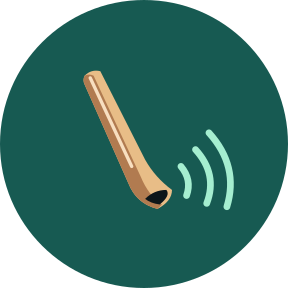
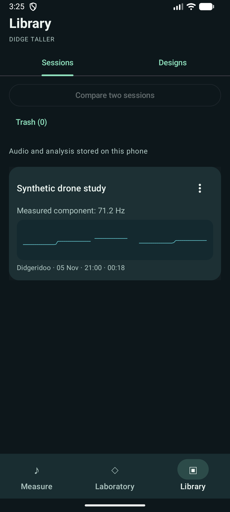

<p align="center">
  
</p>

<h1 align="center">Didge Taller</h1>

<p align="center"><strong>An offline Android workspace for listening, recording, and exploring didgeridoo and Native American flute sound.</strong></p>

<p align="center"><a href="README.es.md">Spanish documentation</a> · <a href="docs/DEVELOPMENT.md">Development guide</a> · <a href="LICENSE">MIT license</a></p>

Didge Taller brings live pitch readings, WAV recording, and saved-session analysis into one app. It keeps audio and analysis on the device unless you choose to export a WAV. The app is a personal, noncommercial beta: its acoustic readings are useful practice evidence, not calibrated physical measurements.

## Inside the app

<table>
<tr>
<td width="50%" valign="top">
  <a href="docs/screenshots/showcase/session-analysis.png"></a>
  <p><strong>Saved session.</strong> Tap the graph to seek, or drag across it to scrub. The cursor, time and supported component readout follow the same position.</p>
</td>
<td width="50%" valign="top">
  <a href="docs/screenshots/showcase/spectrogram.png"></a>
  <p><strong>Spectrogram.</strong> See how spectral energy and its harmonic bands change through the recording.</p>
</td>
</tr>
<tr>
<td width="50%" valign="top">
  <a href="docs/screenshots/showcase/live-measurement.png"></a>
  <p><strong>Live measurement.</strong> Read an accepted pitch estimate, note, and signal status while playing.</p>
</td>
<td width="50%" valign="top">
  <a href="docs/screenshots/showcase/harmonic-analysis.png"></a>
  <p><strong>Harmonic analysis.</strong> Inspect peaks from an analyzed WAV, with frequency in Hz and relative level in dB.</p>
</td>
</tr>
<tr><td colspan="2" align="center">
  <a href="docs/screenshots/showcase/library.png"></a>
  <p>Library. Original audio, supported component previews and session actions stay together.</p>
</td></tr>
</table>

The five featured images are unaltered captures from the real app on an English-configured emulator. The session images use synthetic demonstration audio processed by the app; the live reading uses controlled synthetic PCM. They illustrate behavior, not physical accuracy. [Capture conditions and provenance](docs/screenshots/showcase/README.md).

## What you can do

- **Measure and record.** Choose a didgeridoo or Native American flute profile, follow YIN-based live pitch readings with uncertainty feedback, and save mono PCM16 WAV sessions. Recording limits are configurable from 1 to 30 minutes.
- **Return to your sessions.** The Library shows saved recordings with musical-trace previews. Play, seek, rename, export WAV, compare sessions or excerpts, and recover items from Trash.
- **Explore the sound.** Switch among Drone, Spectrogram, Wave, and Harmonics in a session. Analyze the whole WAV or a selected interval; use full-screen zoom, pan, cursor inspection, and playback-linked navigation. Tools contain scales, ranges, excerpts, and markers.
- **Examine technical evidence.** A separate Advanced diagnostics area exposes saved readings, YIN interpretation, and optional experimental SWIPE′ comparison without changing the ordinary drone chart.
- **Experiment with design.** The didgeridoo Laboratory offers bore-profile editing, approximate resonance simulation, and exploratory search. It is not a validated construction specification. See the [Laboratory guide](README-LAB.md).

The interface supports English and Spanish through Android's app-language settings. Didge Taller needs no account, advertising service, or Internet permission.

During active recording or playback in the foreground, the app requests that the display stay awake. Pausing or finishing releases that request; it does not enable background microphone capture.

## A typical session

1. Choose an instrument in **Measure**, then start measurement and recording.
2. Save to keep the original WAV and its captured readings in **Library**, or discard after confirmation.
3. Open the session to listen and follow its chart. Use the horizontal tabs to inspect the spectrogram, waveform, or harmonic spectrum.
4. Run WAV analysis when you want spectral and harmonic detail. Open **Tools** for ranges, excerpts, markers, and advanced diagnostics.

For didgeridoo, the ordinary **Drone** curve tracks a supported low-frequency spectral component. It is **not** a physically confirmed lip-oscillator fundamental, and it is not automatically assigned a musical note. Live YIN readings and advanced YIN/SWIPE′ diagnostics answer different questions; the original historical readings remain accessible. The [session explorer guide](docs/SESSION_EXPLORER.md) and [acoustic uncertainty notes](docs/ACOUSTIC_UNCERTAINTY.md) explain these distinctions.

## Build from source

You need Android Studio, JDK 17 as the documented Gradle baseline, Android SDK Platform 35, NDK 27.0.12077973, and CMake 3.22.1. The repository includes the Gradle wrapper.

```sh
git clone https://github.com/hmeclazcke/DidgeTaller.git
cd DidgeTaller
```

Open the repository in Android Studio and run the `app` configuration on an Android 8.0+ emulator or a device you control. Or build the debug APK from the repository root:

```powershell
# Windows PowerShell
.\gradlew.bat :app:assembleDebug
```

```sh
# macOS / Linux
sh ./gradlew :app:assembleDebug
```

The APK is written to `app/build/outputs/apk/debug/app-debug.apk`. This is a debug build, not a signed production release or a Play Store distribution. Preserve app data and check signing compatibility before updating an installation that contains recordings. Run instrumented tests only on an explicitly selected emulator. The [development guide](docs/DEVELOPMENT.md) has test commands and device-safety details.

## Engineering and limits

The Android app uses Kotlin, Jetpack Compose/Material 3, `AudioRecord`, and `MediaPlayer`. Kotlin DSP code handles YIN-based periodicity, FFT/STFT, WAV analysis, and exploratory acoustic modeling; SWIPE′ uses a small C/JNI component with [upstream notices](app/src/main/assets/third_party/SWIPE.txt). Start with the [architecture overview](docs/ARCHITECTURE.md), [audio analysis](docs/AUDIO_ANALYSIS.md), and [validation records](docs/VALIDATION.md).

Phone microphones, room noise, strong harmonics, vocalizations, and short attacks can make a pitch estimate uncertain or unavailable. The app preserves gaps rather than inventing readings. Spectral levels are relative digital values, not calibrated sound-pressure levels; simulation results are exploratory. Synthetic tests and emulator captures do not establish physical acoustic accuracy or universal device compatibility.

JVM and emulator tests cover the relevant code paths. GitHub Actions runs JVM tests, builds the debug and Android-test APKs, checks localization, and produces informational Detekt and JaCoCo reports; it **does not execute** Android instrumentation tests. See [Development](docs/DEVELOPMENT.md) for current checks and [SWIPE′ comparison](docs/SWIPE_COMPARISON.md) for its experimental limits.

## Engineering Practices — Inspired by Uncle Bob's ub-mode

The [project-local skill](.agents/skills/ub-mode/SKILL.md) adapts Robert C. Martin's
[ub-mode](https://github.com/unclebob/ub-mode) as engineering instructions used by
Codex. It is not an autonomous development agent, an identical upstream copy, or
an endorsement by the original author.

1. **First Make it Work:** understand the domain, validate boundaries, find root
   causes and give mutable state an explicit owner. For meaningful behavioral
   changes, prefer TDD: a failing regression, the smallest working change, then
   refactoring. Keep each step small enough to verify.
2. **Then Make it Right:** improve structure without changing verified behavior.
   Apply DRY (Don't Repeat Yourself) to shared rules, remove unnecessary complexity
   and use behavioral tests and coverage evidence to guide architectural work.
3. **Practice:** keep context focused, automate repeatable checks safely, make
   reviewable commits and choose validation according to risk. Audio uncertainty
   and recording integrity take priority over cosmetic results.

BDD-style acceptance scenarios describe observable outcomes; they do not imply a
Cucumber integration. JUnit JVM tests check deterministic logic, and selected
Android/Compose instrumentation tests exercise real emulator interactions and
synthetic-WAV playback. Synthetic signals do not prove physical acoustic accuracy.

| In use | Role |
| --- | --- |
| Gradle, JUnit, Android instrumentation | Builds, focused regressions and emulator verification |
| Detekt | Informational static analysis and complexity reports |
| JaCoCo | Informational JVM coverage; coverage alone is not test effectiveness |
| GitHub Actions | JVM tests, APK builds, localization and quality reports; Android tests are compiled, **not executed** |

The upstream tools remain **references, not integrated Kotlin checks**:
[Dryer](https://github.com/unclebob/dryer) relates to duplication analysis;
[Crapper](https://github.com/unclebob/crapper) implements CRAP (Change Risk
Anti-Patterns), combining complexity and test coverage to highlight risk;
[Mutator](https://github.com/unclebob/mutator) evaluates whether tests detect
intentional code mutations. [UML Viewer](https://github.com/unclebob/uml-viewer)
illustrates architectural visualization. This repository claims no automatic
Kotlin architecture extraction, calculated CRAP threshold, mutation score or
duplication gate. These tools are not installed by the local skill.

See the [language policy and audit](docs/LANGUAGE_POLICY.md) for the distinction
between English developer material, bilingual UI and preserved historical records.

## License and contributions

Didge Taller is licensed under [MIT](LICENSE). DidgeLab and CADSD are research references, not bundled engines; attribution context is in the [Laboratory guide](README-LAB.md). Before contributing, read [AGENTS.md](AGENTS.md), keep changes focused, and leave private audio, local diagnostics, and credentials out of Git.
