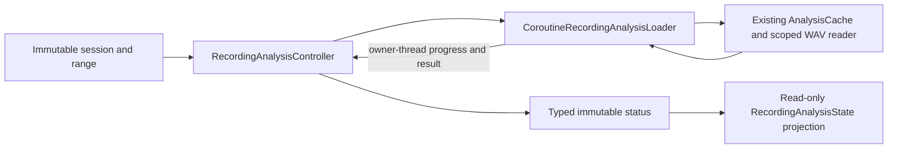

# Recording analysis ownership and plot boundaries

Status: source 8b73c21 remotely verified; see the [source-scoped report](ANALYSIS_RENDERING_VERIFICATION_8b73c21.md). The complete
application rebuild remains IN PROGRESS. Implementation a4dd88a plus the bounded axis-readability follow-up; source baseline
806db72. Original main
3a160043f9ebb3a420b1d89a9cf4ddfe7d1b5d67 remains untouched.

Implementation entry points: [operation owner](../../app/src/main/java/ar/didgetaller/core/RecordingAnalysisController.kt),
[scoped adapter](../../app/src/main/java/ar/didgetaller/audio/RecordingAnalysisLoader.kt),
[ready frame](../../app/src/main/java/ar/didgetaller/ui/PlotFrame.kt),
[paint pipeline](../../app/src/main/java/ar/didgetaller/ui/PlotContent.kt) and
[label preparation](../../app/src/main/java/ar/didgetaller/core/AxisDrawing.kt).

## Analysis protocol

TallerViewModel previously coupled an executor, a generation counter, Handler
progress callbacks and independently copied presentation flags. A controlled
loader seam retained the counter acceptance rule. A real API 37 test then failed:
progress delivered after terminal failure changed the completed presentation.
This proves the missing terminal claim under that callback contract; it does not
claim that the original built-in cache routinely delivers callbacks out of order.

The owner invalidates before cancelling a replaced task, claims terminal delivery
once and rejects stale progress/results. Progress is bounded and monotonic within
one request. Cancellation cannot overwrite an already completed result; explicit
clear still clears the presentation. Disposed is permanent. Error observers do
not prevent owned cancellation in finally. Ready requires a result; Failed and
Cancelled are distinct outcomes. The public Application constructor remains.

The coroutine adapter uses the ViewModel scope and a serial IO dispatcher view.
Queued cancellation prevents work, and expensive work observes its own coroutine
cancellation predicate. Cancellation is cooperative, not an assertion that an FFT
is interrupted instantly. AnalysisCache still owns reader closure, fingerprints,
acoustic algorithms and atomic cache publication. No recording/index format changes.

Eleven owner, five coroutine and two presentation JVM tests plus three native
ViewModel tests cover replacement, duplicate/inline terminals, failed scheduling,
queued progress, failure/retry, disposal, navigation and cleanup when an observer
throws. The initial native RED and subsequent three-case GREEN are retained under
ignored checkpoints/workspace. Focused PIT: 65 mutants, 52 killed/13 survived,
zero uncovered or tool errors. Reentrant disposal, duplicate-disposal publication
and cancellation-observer cleanup tests killed actual weaknesses in the first run.
Generated coroutine/Unit returns and overlapping defensive guards remain visible.

## Rendering responsibilities

* PlotFramePolicy and AxisDrawing prepare tick policy, label space and positions;
  PlotFrame owns native font metrics and freezes the left origin during gestures.
* PlotGestureCoordinates maps the measured rectangle, viewport offset, log scale,
  pan and zoom. PlotInteraction binds the existing one/two-finger priority engine.
* TraceDrawing and TraceEvidence preserve canonical/legacy provenance, gaps,
  comparison links and the one-hop comparison viewport margin. A canonical gap
  never falls back to historical pitch.
* SpectrumGeometry prepares source-bin maxima, relative-power positions and
  existing harmonic candidates. PreparedPlotInk caches platform paths/rasters by
  geometry rather than cursor-only updates.
* PlotContent/PlotInk consume immutable drawing inputs. Their painters cannot
  select sessions, seek audio, start jobs or mutate ExplorerState. PlotCanvas owns
  clipping and native text. PlotAccessibility shares the same authoritative seek
  callback and uses configuration-aware localized resources.

JVM tests capture actual DrawScope calls without Android pixels: they check layer
order, positions, colors, strokes, uncertainty, label overlap, raster transforms
and balanced context restoration. Separate geometry/property tests cover real
plot bounds, a panned 60-second selection, log coordinates, gaps, normalization
under measured-power gain, tick provenance and viewport boundaries. These tests
do not substitute for actual Android gestures or screenshots.

The frame is a ready-to-draw value with a non-null projection. One boundary
rejects inadequate measured dimensions; painters and gesture adapters trust it.
When that value disappears, Compose unmounts the pointer owner and its existing
finally path cancels the preview. A deterministic native RED demonstrated that
the earlier nullable-projection pipeline left an active scrub behind after
collapse. Two native contracts now cover collapse/reappearance, panned midpoint
mapping and cancellation without a hidden committed seek. The placeholder retains
the same test identity and measurement modifier.

The final same-file Detekt comparison is recorded below after canonical
verification. It counts named functions and decisions (MCC minus one per function)
separately; moving decisions into helpers is not automatically an aggregate
complexity reduction. Constructors and unsupported Compose coverage correspondence
are not disguised as scored methods. No hidden giant helper replaces the facade.

## Scientific text accessibility

Inspection of the final 150% landscape PNG also exposed colliding numeric Y-axis
glyphs in a short plot. A pure deterministic RED produced three glyphs where only
two rows fit. AxisDrawing now omits only crowded glyph groups, preserving exact
tick/grid positions, numeric values, projection and all seek coordinates. Musical
frequency/note pairs remain together; no font scaling is disabled. Three boundary
contracts cover numeric and two-line musical labels. This is an intentional
readability correction to the original clamped-baseline behavior.

The fullscreen explanation had maxLines=2. After one independently captured System
UI ANR obstructed the fresh emulator, a bounded retry reached the intended failing
GetTextLayoutResult.hasVisualOverflow assertion at 150% font. Removing that cap
lets the explanation wrap without shrinking text or changing scientific wording.
A subsequent full API 37 suite exposed a default-font intrinsic-width overflow
(didOverflowWidth=true, without height overflow). Giving the explanation the
available parent width fixes that constraint without relaxing the assertion.
The regression selects the exact tagged description, checks the full resource
text, the final laid-out character, overflow and parent-clipped bounds. EN and ES
150% compact portrait and EN landscape pass with inspected unaltered PNGs. Both
portrait descriptions have three fully visible lines; landscape has two. A
wrong-locale probe was rejected before setup; reruns set the actual application
locale through Android's locale command. Infrastructure failures remain separate.

No physical acoustic accuracy, CPU/FPS improvement or completed whole-application
rebuild is claimed. Local full API 37 evidence before the last fixes remains
146 passed, one genuine text failure and nine skips. Focused final readiness and
description cases pass; the subsequent clean API 35 full suite passes separately,
as recorded in the source-scoped report.
The unchanged 741-case original-main differential probe passes separately and is
not advertised as pixel equivalence for the entire UI. No Samsung/private WAV access.

The evidence test now checks the existing private-fixture authorization policy
before either optional external WAV or points input is read. A nonexistent
synthetic path without authorization produces the expected assumption rejection,
not a file read or FileNotFound error. Default synthetic evidence remains enabled.

## Canonical local verification

| Measure | Prior source ec19b18 | This source, before publication |
| --- | ---: | ---: |
| JVM discovered / passed / skipped, both variants | 796 / 780 / 16 | 896 / 880 / 16 |
| JVM lines / branches | 39.71% / 36.43% | 42.57% / 38.74% |
| Pure core lines / branches | 98.98% / 82.70% | 98.99% / 83.28% |
| CRAP-L measured / independent unscored | 436 / 96 | 470 / 111 |
| JVM above-target scores | 75 | 73 |
| Detekt informational findings | 1,970 | 1,989 |
| Lint errors / warnings / hints | 0 / 52 / 8 | 0 / 52 / 8 |
| CPD groups >=100 tokens | 0 | 0 |
| Original-main synthetic differential results | 741 identical | 741 identical |

Production and generated-code denominators grow with the new implementation;
these are reproducible source-scoped counters, not same-denominator percentages.
The 621 named PSI declarations are 470 measured, 36 nested in their parent metric,
30 bodyless, 13 anonymous-owner and 72 Compose-transformed. Four local anonymous
implementations are parent-accounted; the independent Detekt unscored count is
111 = 72 Compose + 30 bodyless + nine other anonymous declarations. No new eligible
ordinary function has a missing-score waiver. Exact content-linked auxiliary and
Compose technical reviews do not assert unavailable source-level coverage.

The explicit comparable renderer/preparation file set (including WaveDrawing)
changes from eight named functions, MCC sum 171 / 163 decisions / maximum 127,
to 48 functions, sum 215 / 167 decisions / maximum nine. PlotSurface itself goes
127 -> eight and cognitive 279 -> seven. Thus four additional decisions remain,
while responsibilities and worst-function complexity improve substantially.
This is not a claim that moving branches reduced their total. Analysis entry goes
MCC eight -> one; owner request/cancel/finish/close and adapter submit score
CRAP-L 5 / 5 / 3 / 2 / 4, all with 100% method-line coverage.

Focused real PIT: analysis 65 = 52 killed + 13 surviving; plots 426 = 345 killed +
79 surviving + two uncovered. Detection denominators are 65 and 426 (80.00% and
80.99%); zero timeouts/tool errors. Wider scope differs from the earlier plots
124-mutant selection. Tests added after actual reports protect gain-invariant
spectrum normalization, measured label widths, raster coordinates/context
restoration, colors and region bounds. Two uncovered paths are Kotlin stdlib
count-overflow guards, still reported rather than hidden. Other survivors need
individual domain/equivalence review; no blanket equivalent classification.

Quality-tool Python tests: 45; engineering-tool Java tests: five. Localization
checks preserve 576 strings, five plurals and two arrays. Canonical tasks use
`-Pkotlin.incremental=false`, both JVM variants, Lint, Detekt, debug/androidTest
builds, source/bytecode inventory, JaCoCo, CPD, differential and focused PIT.
`python tools/quality_gate.py` rejects unreviewed technical changes and passes
only after exact supported reviews; numerical baselines and gate logic unchanged.
Full current-source API 35 CI, separate Android coverage and broad domain PIT
are now observed in the source-scoped report above, with Linux counters kept
separate from this local table.

The axis follow-up's PIT report exposed the exact-fit spacing boundary and a
previously unasserted note-row X offset. Explicit fit/offset assertions kill both
mutants without changing correct production behavior. All AxisDrawing mutants
are now killed in the selected report; this does not imply whole-renderer or
whole-app mutation completeness. The initial compact-axis RED, native text RED,
hidden-scrub RED and failed infrastructure probes remain available in ignored
checkpoints/workspace rather than being overwritten with passing evidence.

Final axis native check: explicit emulator-5580 (API 37, synthetic-only AVD),
720x1280, 150% system font, EN landscape and ES portrait both execute and pass.
The inspected landscape PNG shows separated 140/35 Hz labels while the middle
grid line retains its true position; the scientific sentence remains complete.
The emulator was restored to normal font/size/EN and stopped. These focused cases
are not substituted for the independently passing full clean API 35 suite or
its separate Android coverage.

Residual UI scope: the pre-existing fullscreen empty-evidence overlay can cross
the Y-label area at 150%; the source-scoped report records the exact next
annotation-layout regression. Whole-application and UI acceptance remain IN PROGRESS.
