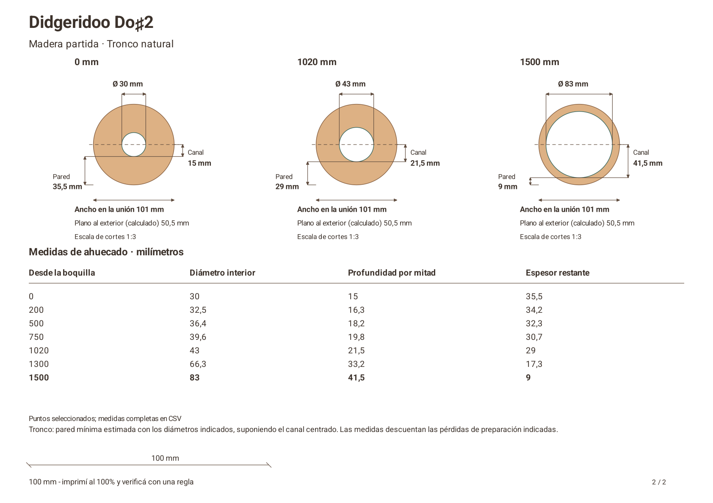
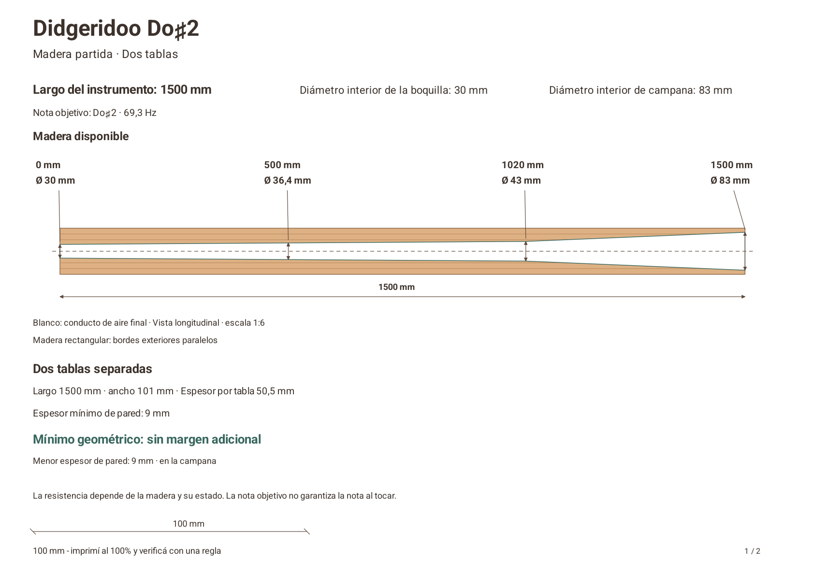
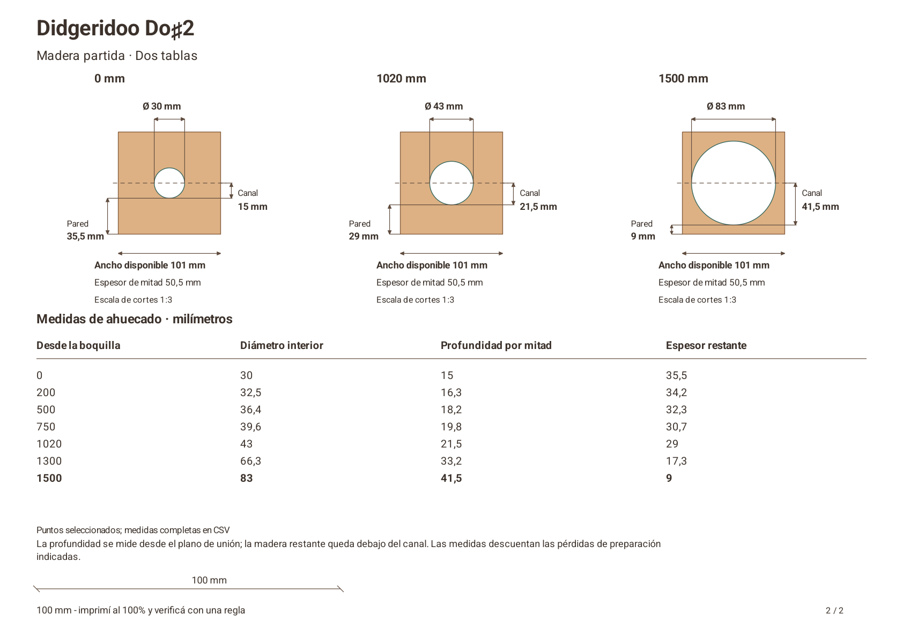
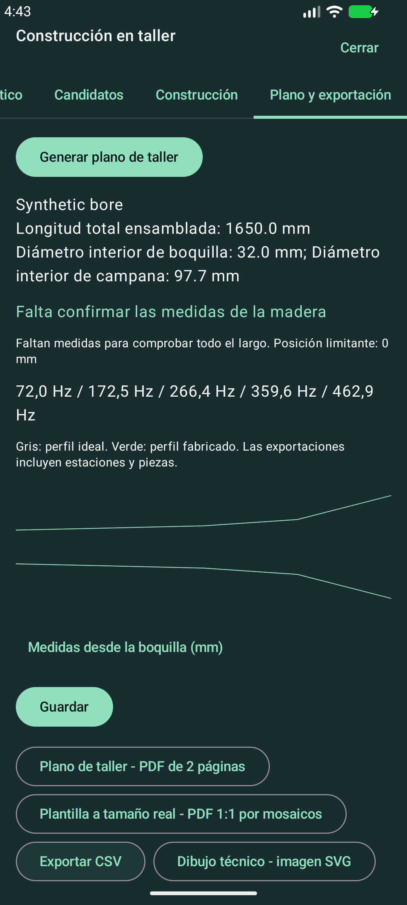

# Stock-aware workshop plans — authentic synthetic examples

These are actual Android-generated PDFs and PdfRenderer captures from a fresh,
task-owned API 37 emulator, using synthetic data only. Final native execution passed
three cases: bilingual document generation, calibrated 1:1 templates and the actual
Compose search/save/tolerance/PDF/CSV/SVG workflow. The [manifest](manifest.json)
records the starting revision, exact generator-source hashes and artifact hashes;
source hashes normalize newlines. No private recording or physical device is used.

| Case | English PDF | Spanish PDF | Precise SVG | Full CSV |
|---|---|---|---|---|
| Natural log, declared cylindrical minimum | [PDF](english-sandwich-log.pdf) | [PDF](spanish-sandwich-log.pdf) | [EN](english-sandwich-log.svg) / [ES](spanish-sandwich-log.svg) | [EN](english-sandwich-log.csv) / [ES](spanish-sandwich-log.csv) |
| Two rectangular boards | [PDF](english-sandwich-boards.pdf) | [PDF](spanish-sandwich-boards.pdf) | [EN](english-sandwich-boards.svg) / [ES](spanish-sandwich-boards.svg) | [EN](english-sandwich-boards.csv) / [ES](spanish-sandwich-boards.csv) |
| Wood not measured: fit unconfirmed | [PDF](english-sandwich.pdf) | [PDF](spanish-sandwich.pdf) | [EN](english-sandwich.svg) / [ES](spanish-sandwich.svg) | [EN](english-sandwich.csv) / [ES](spanish-sandwich.csv) |
| Measured PVC | [PDF](english-pvc.pdf) | [PDF](spanish-pvc.pdf) | [EN](english-pvc.svg) / [ES](spanish-pvc.svg) | [EN](english-pvc.csv) / [ES](spanish-pvc.csv) |

Each default PDF contains exactly two A4 pages. For split wood, page 1 shows the
available stock and the complete bore with distance/diameter callouts. Page 2 uses
three full transverse sections and a short carving table; the two confusing long
half-views have been removed. Rectangular outside edges remain parallel. Log
contours use measured bounds, never an invented exterior cone.

The groove depth is half the bore diameter. Remaining wood below a board groove
uses the actual prepared half thickness; the separate minimum-wall calculation
also checks its sides. A log uses its prepared circular cap and joining-plane
offset. Unknown or unconfirmed measurements stay unavailable, not invented.
Selected print stations are also included in the full-precision CSV.

The wood profile is 1500 mm long,
30 mm at the mouth,43 mm at 1020 mm and 83 mm at the bell: it is not a fabricated
straight 30→83 taper. Known-stock examples use a 9 mm illustrative radial wall and
zero additional losses to expose the exact dimensional boundary. The log is 101 mm
in minimum diameter; each board is 101 mm wide × 50.5 mm thick. Bore diameter 83 mm,
groove depth 41.5 mm and stock thickness 50.5 mm are distinct axes. The joined board
envelope remains rectangular, not automatically a 101 mm round outside surface.
These zero-margin specimens are numerical examples, not recommended stock orders.
Real preparation losses, irregularity, species/grain and workmanship need assessment.

The main sheets are reduced views with separate cross-section scales. The optional
[true-size tiled template](spanish-sandwich-tiles.pdf) has 10 sheets and 10 mm overlaps;
[all tile previews](tiles-contact.png) show registration references. Print at 100%
and measure the 100 mm ruler physically before trusting scale. Neither printer
accuracy, wood strength nor the played drone has been physically validated here.
The measured synthetic PVC assembly is 1485 mm.

English previews have matching `english-*-page-1.png` / `page-2.png` filenames.
The unmeasured wood case is deliberately neutral and never claims the wood fits.
CSV retains exact station sides and measured capacity; SVG uses the same geometric
marks as the second PDF page. Final UI/fast-CI evidence is linked in [draft PR #5](https://github.com/hmeclazcke/DidgeTaller/pull/5).

The editorial revision localizes the synthetic sample title only. Log sections
label derived joining-plane dimensions explicitly; boards keep rectangular-stock
labels. Boundary examples state that they have no additional geometric allowance.
All eight requested bilingual board/log pages were rendered and visually inspected.
Real user-selected design names are preserved.

Current plan headings use the actual instrument name or Didgeridoo plus the target
note, with localized stock/method subtitles on both pages. No generic sample title
is used. Transverse-layer construction is no longer offered for new designs;
its stored representation and exports remain supported for legacy projects only.
