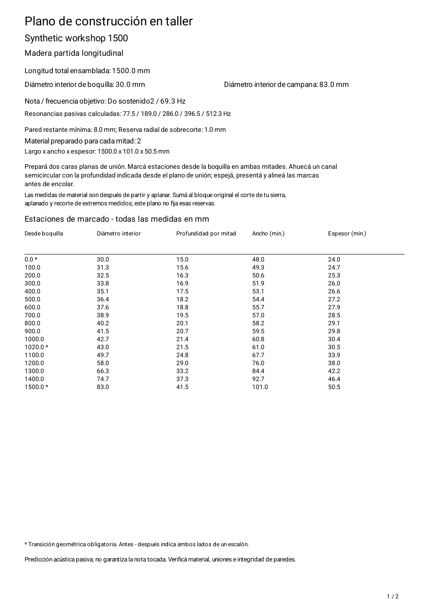
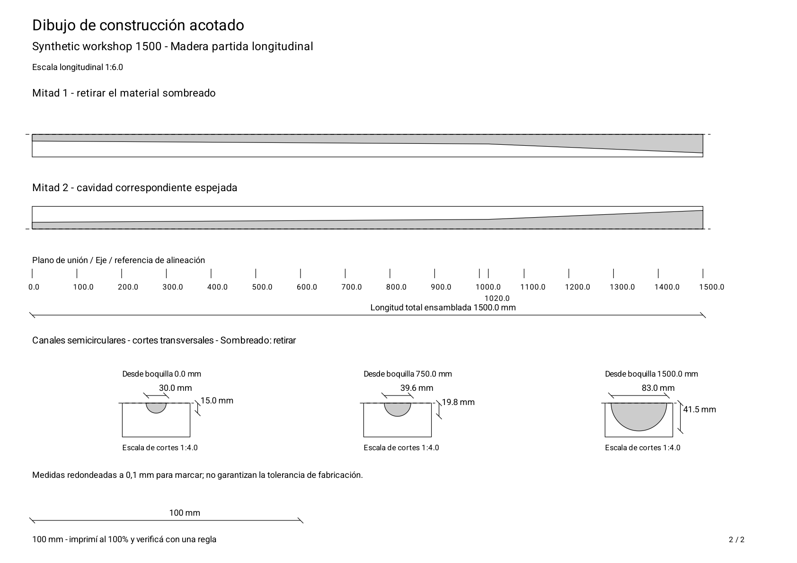
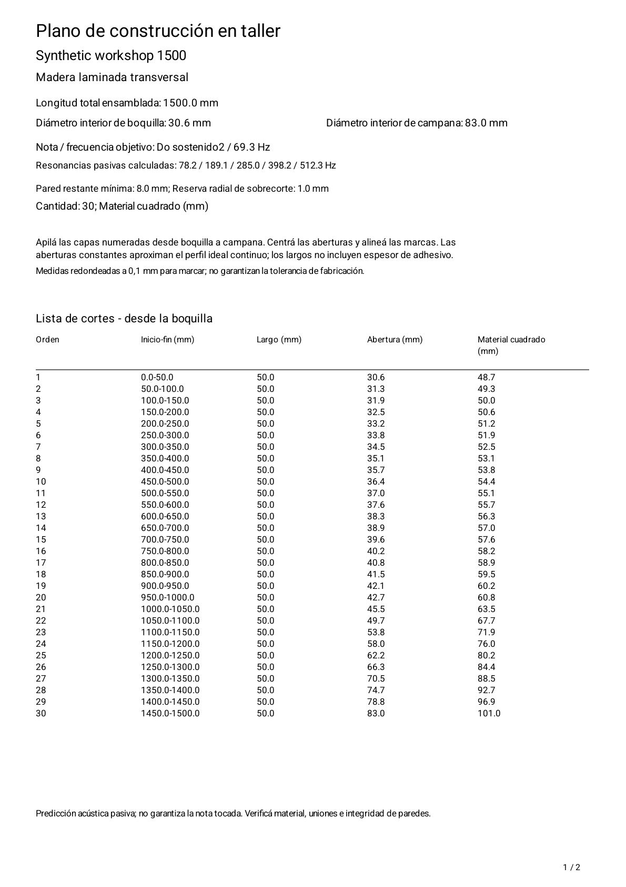
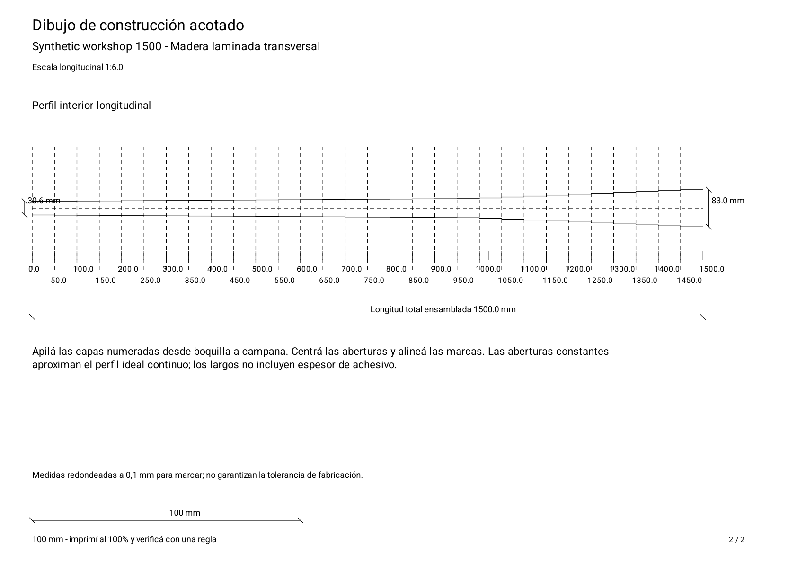
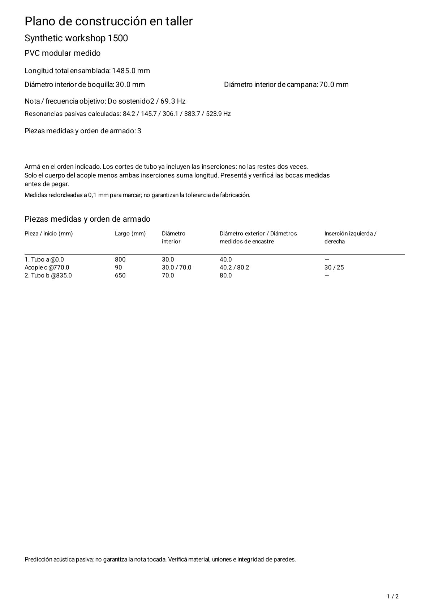
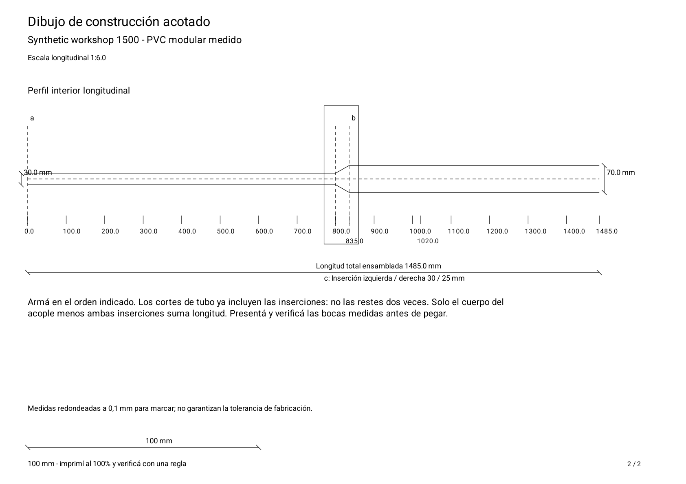
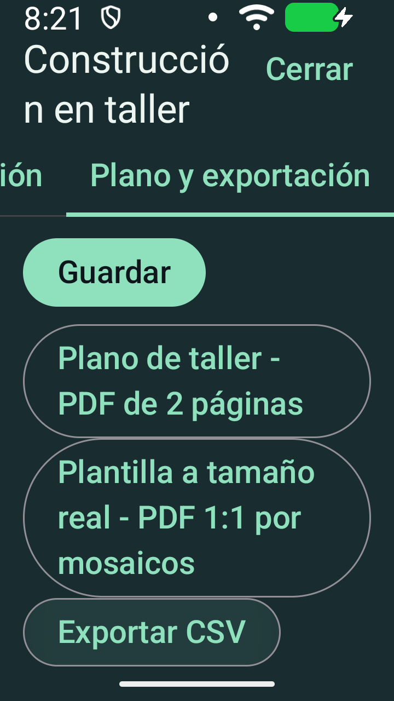

# Synthetic workshop export examples

These are actual Android-generated PDFs and PdfRenderer page captures, not mockups.
Source fixture: `WorkshopDocumentsUiTest`. Wood:1500 mm length,30 mm mouthpiece,
83 mm bell,8 mm wall and1 mm radial reserve. Laminated wood uses50 mm layers.
PVC uses two synthetic measured tubes and one measured reducer:1485 mm assembled.
The shared example title is user-provided text, preserved in both languages.
No personal designs, audio, device identifiers or physical-device captures are used.

| Method | English plan | Spanish plan | Vector drawing | Measurements |
|---|---|---|---|---|
| Split wood | [PDF](english-sandwich.pdf) | [PDF](spanish-sandwich.pdf) | [EN](english-sandwich.svg) / [ES](spanish-sandwich.svg) | [EN](english-sandwich.csv) / [ES](spanish-sandwich.csv) |
| Laminated wood | [PDF](english-laminated.pdf) | [PDF](spanish-laminated.pdf) | [EN](english-laminated.svg) / [ES](spanish-laminated.svg) | [EN](english-laminated.csv) / [ES](spanish-laminated.csv) |
| Measured PVC | [PDF](english-pvc.pdf) | [PDF](spanish-pvc.pdf) | [EN](english-pvc.svg) / [ES](spanish-pvc.svg) | [EN](english-pvc.csv) / [ES](spanish-pvc.csv) |

Every default plan has exactly two A4 pages. The separately requested
[full-size template](spanish-sandwich-tiles.pdf) has10 sheets with10 mm overlaps;
[contact sheet](tiles-contact.png) shows every tile. Print at100% and measure the
100 mm reference with a ruler before using it. Physical print accuracy, material
strength and played note are not validated by these synthetic examples.

English previews use the matching `english-*-page-1.png` / `page-2.png` filenames.
The manifest records file hashes for provenance. These are presentation examples,
not physical acoustic validation or permission to skip workshop measurements.

